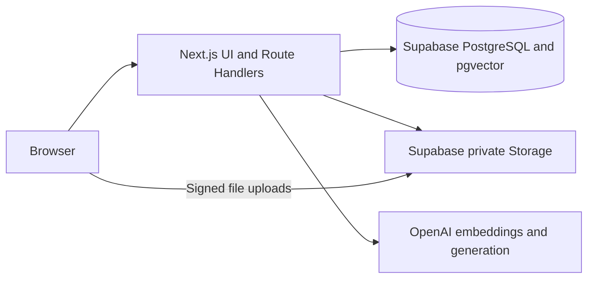

# Rewoven

**Team memory for your next project.**

Rewoven helps delivery teams find relevant past projects, understand what changes this time, and build a reuse plan with sources they can check.

<p align="center">
  
</p>

<p align="center"><em>Meet Wren, your guide to finding and reusing the team’s past experience.</em></p>

## Why Rewoven?

Useful project knowledge often stays scattered across briefs, implementation notes, and delivery reviews. When a new request arrives, teams need to understand which earlier decisions still apply, what failed, and what needs to change.

Rewoven brings those records into a searchable case library. Ask Wren about a new request, follow the supporting evidence, and turn relevant lessons into an editable plan for discussion with your client or engineering team.

**New request → relevant past cases → similarities and differences → reuse plan.**

## What you can do

| Capability               | How it helps                                                                                                                |
| ------------------------ | --------------------------------------------------------------------------------------------------------------------------- |
| **Build a case library** | Add historical projects with PDF, TXT, or Markdown sources. Review AI-assisted overviews or enter project details manually. |
| **Ask Wren**             | Explore previous decisions, compare projects, and ask follow-up questions in a saved conversation.                          |
| **Bring a new request**  | Attach client documents in chat and describe your constraints. Request files stay separate from historical cases.           |
| **Check the evidence**   | Open numbered citations to inspect the original PDF page or extracted text behind an answer.                                |
| **Control the search**   | Search the full library or focus a chat on up to five selected cases.                                                       |
| **Prepare a reuse plan** | Review the request, generate a cited draft, edit it, explicitly save it, and export Markdown.                               |

## Try the demo

The demo follows **Threadline Delivery**, a fictional software delivery company with nine past projects. **Northbank Services** brings a new request for a purchasing tool. The archive includes delivered projects, a failed pilot, and an unimplemented proposal, giving you different kinds of evidence to compare.

All companies, clients, incidents, and outcomes in the demo are fictional.

1. **Meet the archive.** Open the app and follow the welcome walkthrough. You can replay it through **How to use Rewoven** in the navigation.
2. **Bring Northbank’s request.** Start a new chat and attach `client-brief.pdf` and `constraints.md` from the [client input folder](output/pdf/rewoven-purchase-demo/upload/Client%20input/). Files are read when you choose **Send**.
3. **Ask what applies.** The default search includes all nine prepared projects and cases you have added during your session. Try:

   > Which previous projects help with this purchasing request? Explain what we can reuse, what changes, and what is still unknown. Cite the original sources.

4. **Inspect a citation.** Check the source before relying on a recommendation. A proposed design and a recorded delivery result carry different weight.
5. **Draft the next plan.** Choose **Draft reuse plan**, review the request, and generate a draft. Make your edits, choose **Save**, then **Export Markdown**.

You can also begin with a typed question and no attachments. For example:

> What happened in the Invoice Matching Pilot, and what should a new purchasing project learn from it?

See the [purchasing demo guide](docs/features/purchasing-demo.md) for the complete story, source pack, and presentation walkthrough.

## Meet Wren

Wren is Rewoven’s conversational case advisor and illustrated team archivist. She helps you navigate previous work, connect relevant lessons, and identify questions that still need an answer.

Her substantive answers and recommendations use retrieved project evidence with clickable citations. Search combines keyword matching with semantic retrieval when embeddings are available. Each answer uses a bounded selection of passages, so it may not cover every relevant document. Citations make claims inspectable; you should still check whether a source supports the conclusion.

## Architecture and RAG

Rewoven uses a single Next.js application for the interface and server API. Supabase stores project records, original files, extracted passages, and vectors. OpenAI provides embeddings and structured AI responses. The production deployment configuration targets Vercel.



**Retrieval-augmented generation (RAG)** means Wren retrieves relevant source passages before generating a substantive answer. The current workflow is:

1. **Index past work.** Extract historical PDF/TXT/MD sources into passages of up to 2,000 characters, preserving document identity, PDF page, and text offsets. Store keyword indexes and 1,536-dimensional `text-embedding-3-small` vectors alongside the original text.
2. **Understand the request.** Read client attachments in resumable stages, retaining their own citations separately from historical evidence. Wren prepares up to two search queries for a substantive question.
3. **Retrieve evidence.** Search authorized historical passages using PostgreSQL keyword search and pgvector cosine similarity, combining their ranks with reciprocal rank fusion. The user’s case selection controls the search scope.
4. **Check coverage.** Wren can request one additional targeted search. The server deduplicates and interleaves historical evidence across cases, with a final budget of 30 passages or 60,000 characters.
5. **Answer with references.** Generate a structured answer, validate its citation IDs, and recheck historical source versions and text before saving. Numbered citations open the original source location.
6. **Turn evidence into a plan.** After the user reviews the request, retrieve fresh evidence for plan generation. Keep the generated draft and saved edits separate, with explicit Save and Markdown export.

Keyword search remains available when semantic retrieval fails. Valid citations establish traceable references; they do not guarantee that every conclusion follows from its source.

Read the [architecture and RAG guide](docs/architecture.md) for the data model, ranking algorithm, implementation files, design tradeoffs, safeguards, and verification limits.

## Before you begin

Rewoven is a demo MVP with these current boundaries:

- **Session-based access.** Cases you add, saved chats, and saved plans are accessible through a cookie-backed, 24-hour demo session. Account sign-in and shared team workspaces are not implemented. Session expiry ends access but does not automatically delete stored records or files.
- **Explicit saves.** Unsubmitted chat drafts clear on reload. Save plan edits explicitly and export plans you want to keep beyond the session.
- **AI configuration.** AI answers, document reading, and plan generation require an OpenAI API key. You can use **Use your own API key** in the navigation. A personal key stays in the open page’s memory, passes through Rewoven’s server for AI requests, and clears on reload or close. Requests use that key owner’s API credit and remain subject to application limits. See [personal API keys](docs/features/personal-openai-key.md).
- **Document handling.** Submitted text and selected request and historical source passages are sent to OpenAI for AI processing. Use the fictional demo documents when exploring the app.
- **Evidence limits.** Generated plans are drafts for review. Missing evidence, unrecorded outcomes, and unanswered client questions still require human judgment.

## Run locally

Use **Node.js 20.19 or newer** and **Bun 1.2.15**, as recorded in `package.json`.

```bash
git clone https://github.com/TaiVanNgo/rewoven.git
cd rewoven
bun install --frozen-lockfile
bun run dev
```

Open the URL printed in the terminal, usually `http://localhost:3000`. This starts an interface preview; using the case library, saved chats, and plans requires Supabase configuration. Stop the web server with **Ctrl+C**.

For the complete local demo, follow the [development guide](docs/development.md#quick-start) to configure Supabase, apply migrations, import the nine fictional projects, and enable AI features. It also explains ordinary restarts, stopping services, and running a production build.

## Built with

Rewoven uses **Next.js App Router**, **React**, **TypeScript**, and **Tailwind CSS** for the application; **shadcn/Base UI** and **Motion** for interface components and interactions; **Supabase** for data and private file storage; and **OpenAI** for AI reading, conversation, plan generation, and embeddings. **Bun** manages dependencies, scripts, and tests.

## Learn more

- [Architecture and RAG](docs/architecture.md) — follow the implementation from source ingestion to cited answers and saved plans.
- [Welcome walkthrough](docs/features/onboarding.md) — learn the demo’s story and first steps.
- [Conversations with Wren](docs/features/conversational-queries.md) — ask questions, focus your search, and inspect citations.
- [Request document uploads](docs/features/query-file-uploads.md) — attach current requirements and understand file processing.
- [Case library](docs/features/case-library-and-ingestion.md) — add, review, edit, and delete historical cases.
- [Reuse plans](docs/features/reuse-plans.md) — review, generate, edit, save, and export a plan.
- [Development guide](docs/development.md) — set up the project, understand its structure, and run checks.
- [Deployment guide](docs/features/ci-cd-and-production.md) — configure CI and Vercel production releases.
