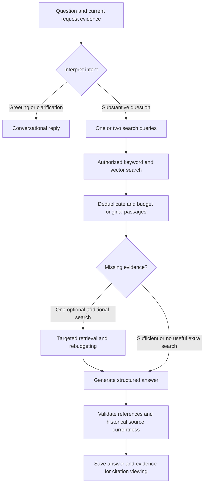

# Rewoven architecture and RAG

Rewoven turns a new client request into a reviewable reuse plan backed by past project records. This guide describes the current implementation and points to the code that enforces each stage. It does not establish deployed indexing coverage or live model accuracy.

For example, Northbank asks for purchasing approvals and safe submission retries. Wren should retrieve the relevant purchasing and expense-reimbursement passages, explain what applies, preserve their limits, and help draft the next plan. A prior AI answer is conversation context; original source passages supply the evidence.

## System boundaries

The [README diagram](../README.md#architecture-and-rag) shows the system at a glance.

| Component                 | Responsibility                                                                                                                                                    | Implementation                                                                                                         |
| ------------------------- | ----------------------------------------------------------------------------------------------------------------------------------------------------------------- | ---------------------------------------------------------------------------------------------------------------------- |
| Next.js App Router        | Pages, layouts, and the interactive workspace. Server Components provide the page structure; Client Components handle chat, uploads, source viewing, and editing. | [`src/app/`](../src/app/), [`src/features/`](../src/features/)                                                         |
| Next.js Route Handlers    | Session checks, source authorization, processing steps, retrieval, AI calls, and persistence. These routes deploy with the application.                           | [`src/app/api/`](../src/app/api/)                                                                                      |
| Supabase PostgreSQL       | Cases, source metadata and passages, vectors, request-file checkpoints, conversations, plans, and usage reservations.                                             | [`supabase/migrations/`](../supabase/migrations/)                                                                      |
| Supabase private Storage  | Historical originals in `case-sources` and current-request originals in `query-files`. The server authorizes signed file access.                                  | [`supabase/config.toml`](../supabase/config.toml), [`sources.ts`](../src/features/cases/server/sources.ts)             |
| OpenAI                    | Document/query embeddings, staged document reading, search planning, evidence review, structured answers, and plan generation.                                    | [`embeddings.ts`](../src/features/cases/server/embeddings.ts), [`openai.ts`](../src/features/queries/server/openai.ts) |
| Vercel and GitHub Actions | Vercel’s configured production build applies migrations and storage configuration after building; GitHub Actions runs checks against disposable local Supabase.   | [Deployment guide](features/ci-cd-and-production.md)                                                                   |

File bytes upload directly from the browser to a server-authorized Storage path. This supports the 5 MB file limit without routing the original through a server function’s request body. Application records and retrieval go through the server API. The Supabase server credential stays in server-only code.

## The data model preserves provenance

Historical evidence follows **case → source document → source chunk**. One project can have a brief, implementation notes, and a delivery review without merging their identities or treating their statements as equally conclusive.

| Record                                | What it preserves                                                                                                                             |
| ------------------------------------- | --------------------------------------------------------------------------------------------------------------------------------------------- |
| `cases`                               | Project metadata, session ownership or fictional sample status, and the reviewed overview.                                                    |
| `source_documents`                    | The immutable original’s path, format, version, extracted pages, processing progress, and indexing status.                                    |
| `source_chunks`                       | Original passage text, source ID, page number, exact character offsets, English keyword index, and optional embedding.                        |
| `query_conversations` / `query_turns` | The question, case-scope snapshot, processing state, retrieved evidence, structured answer, and warnings.                                     |
| `query_files`                         | Current-request originals, extracted pages, staged findings, and resumable reading progress. These files stay outside historical case search. |
| `reuse_plans`                         | The originating chat snapshot, reviewed request, evidence snapshots, generated content, saved Markdown, and processing state.                 |

Evidence snapshots preserve what supported an answer or plan. When a historical case is deleted, saved material can retain excerpts while showing that the original is unavailable. Database evidence deletion and retryable Storage cleanup have separate responsibilities; see [case deletion](features/case-library-and-ingestion.md#edit-or-permanently-delete-a-case).

## Historical ingestion: prepare searchable evidence

1. **Reserve and upload.** The server checks the session and quotas, reserves an immutable source path, and returns a signed upload capability. Completion checks the stored original against the reservation.
2. **Extract text.** TXT and Markdown use UTF-8 decoding. Text-based PDFs are processed in checkpoints of at most ten pages. Extracted PDF page boundaries are retained. Scanned PDFs require OCR, which is outside the current implementation.
3. **Chunk without losing locations.** `chunkPages()` produces non-overlapping passages of up to 2,000 UTF-16 characters, preferring paragraph or whitespace boundaries. It preserves exact offsets and avoids splitting a Unicode surrogate pair. PDF chunks stay within a physical page.
4. **Publish keyword-searchable text.** PostgreSQL generates an English `tsvector` from each passage and indexes it with GIN. This index is separate from the embedding vector.
5. **Add semantic embeddings.** `text-embedding-3-small` embeds batches of up to 16 passages into 1,536-dimensional vectors stored in pgvector. Completed vectors survive retries; an embedding failure leaves readable text available for keyword search.

The browser or an administrative command advances processing through checkpointed server calls. There is no autonomous background queue: leaving the relevant interface can pause further work, although an in-flight call can finish. Extraction and indexing have separate statuses so one failed document need not invalidate the rest of a case.

AI-assisted case reading is another path: it reads saved source excerpts in stages and suggests editable metadata with evidence. Those suggestions do not replace the original passages used for retrieval.

Code: [`extraction.ts`](../src/features/cases/extraction.ts), [`sources.ts`](../src/features/cases/server/sources.ts), [`embeddings.ts`](../src/features/cases/server/embeddings.ts), and the [multi-source migration](../supabase/migrations/202610160002_multi_source_retrieval.sql).

## Client request files follow a separate path

Chat attachments describe the new problem. On Send, extraction and staged AI reading produce saved findings with references to original request passages. `requestDocumentContext()` selects excerpts by question-term matches, prioritizes cited findings on ties, and interleaves files within a separate 30-passage / 60,000-character budget.

Request documents currently receive no stored embeddings and never become historical cases automatically. Their evidence IDs begin with `r_`; they can support statements about Northbank’s requirements, but cannot establish that Threadline delivered a feature in the past. Historical evidence uses turn-local `e` IDs.

Code: [`query-files/server/repository.ts`](../src/features/query-files/server/repository.ts) and [`query-files/content.ts`](../src/features/query-files/content.ts). See [request uploads](features/query-file-uploads.md) for the user workflow and recovery.

## Wren’s RAG pipeline



### 1. Interpret the turn and preserve scope

The server claims the turn using a request ID, context revision, and processing token. Repeated completed requests can reuse the saved result, while conflicting processing or changed case selections are rejected.

Wren classifies the message as conversation, clarification, case-creation guidance, or search. A search produces one or two standalone queries. Default discovery covers active fictional samples and cases owned by the current session. **Add cases** restricts the allowed set to up to five cases.

A planner’s candidate IDs cannot silently narrow library-wide discovery based on an earlier answer: narrowing also requires explicitly named projects in the current message. Deleted selections require the user to choose a new scope. Source text, metadata, and earlier answers are treated as untrusted data in the system prompt.

Code: [`process-assistant.ts`](../src/features/queries/server/process-assistant.ts), [`assistant.ts`](../src/features/queries/assistant.ts), and [`assistant-prompt.ts`](../src/features/queries/server/assistant-prompt.ts).

### 2. Retrieve using keywords and meaning

Each search query is chunked if needed, embedded with the same model as historical passages, then pooled into a normalized, length-weighted vector. The current Wren SQL function, `retrieve_assistant_passages`, searches only authorized Ready sources in an active session.

| Branch   | Current Wren behavior                                                                                                          |
| -------- | ------------------------------------------------------------------------------------------------------------------------------ |
| Semantic | Exact cosine similarity over compatible stored vectors; candidates require similarity of at least `0.40`; retain up to 60.     |
| Keyword  | English full-text search using OR across normalized query terms; rank with `ts_rank_cd`; retain up to 60.                      |
| Fusion   | Combine both rank lists with equal-weight reciprocal rank fusion (RRF), using `k = 50`; return up to 60 passages per SQL call. |

For a passage, `RRF = 1 / (50 + semantic_rank) + 1 / (50 + keyword_rank)`. A missing branch contributes zero. RRF combines rank positions without assuming the two search scores share a scale. The `0.40` threshold is a heuristic, not a confidence probability. Keyword candidates can contribute even when they do not pass the semantic threshold.

With selected cases, separate retrieval calls keep one large case from exhausting the candidate pool before evidence budgeting. Original opening passages are also eligible to support broad attached-case summaries. If query embedding fails, Wren uses keyword matches and exposes a coverage warning.

Code: [`assistant-retrieval.ts`](../src/features/queries/server/assistant-retrieval.ts), [`embedding-math.ts`](../src/features/retrieval/embedding-math.ts), and the [current Wren retrieval SQL](../supabase/migrations/202610190001_assistant_keyword_lexemes.sql). The query is normalized with the English dictionary once, then its OR expression is parsed with the simple dictionary to avoid double-stemming existing lexemes.

### 3. Review and bound the evidence

The server deduplicates chunks, interleaves passages across cases, and assigns turn-local evidence IDs. Historical context is limited to **30 passages / 60,000 characters**. Request context has its own budget; the historical limit is not a total prompt-size limit.

An AI review can ask for one targeted extra search. It can also report that the retrieved subject does not support the question; the server then records a scoped unknown answer without generating unsupported claims. The server rebudgets additional search results before generating the answer. This is a bounded workflow with explicit stages. Warnings identify incomplete indexes, evidence-budget limits, and attached cases that supplied no readable passages.

### 4. Generate, validate, and expose sources

OpenAI returns a structured answer with fact, inference, recommendation, unknown, and conversation sections. Fact, inference, and recommendation sections must reference supplied evidence IDs; greetings and clarification can be uncited. The provider schema limits citation choices to the supplied IDs, and server validation checks the returned structure and references again.

The planner can extract short current-requirement quotes, which the server retains only when they occur verbatim in current typed input or request excerpts. For new-project turns with retained explicit rules, one bounded draft revision compares the generated answer against the current request and original passages before validation and saving. It adds one model request for those turns; it is not a deterministic entailment or policy checker. Technical sections support cited code and safe static diagrams; see [engineering case evidence](features/engineering-case-evidence.md).

Before saving a generated answer, `evidenceIsCurrent()` rechecks historical case access, chunk identity, source version, Ready status, and exact text. The source viewer uses preserved page/offset information to open the original location.

The prompt instructs Wren to distinguish recorded outcomes from proposals and recommendations, retain conflicts, and acknowledge missing evidence. These instructions and citation checks improve traceability; they do not mechanically prove that each sentence follows from its cited passage or eliminate prompt injection.

If no historical or request evidence is retrieved, the workflow saves a no-evidence response. Without AI configuration, keyword excerpts remain available with a paused-answer message.

Code: [`openai.ts`](../src/features/queries/server/openai.ts), [`validation.ts`](../src/features/queries/validation.ts), [`evidence.ts`](../src/features/queries/server/evidence.ts), and [`source-viewer.tsx`](../src/features/cases/source-viewer.tsx).

## Plans retrieve evidence again after request review

**Draft reuse plan** first prepares an editable brief from a saved conversation. Once the user reviews it, that confirmed request defines generation. The plan pipeline retrieves fresh historical evidence under the captured case scope, uses the same evidence budget, and keeps request evidence separate.

Historical plan citations are constrained to the supplied historical references. If no historical evidence is available, the result is a clarification draft. Generated content, evidence snapshots, and explicitly saved Markdown remain separate so user edits do not erase the original generation. Export uses saved content and includes reference excerpts.

Code: [`plans/server/process.ts`](../src/features/plans/server/process.ts), [`plans/model.ts`](../src/features/plans/model.ts), and [`plans/content.ts`](../src/features/plans/content.ts). See [reuse plans](features/reuse-plans.md).

## Design choices and tradeoffs

| Choice                                               | Benefit and current cost                                                                                                                           |
| ---------------------------------------------------- | -------------------------------------------------------------------------------------------------------------------------------------------------- |
| One Next.js application with server-only data access | Keeps the UI and API deployment together. Correct session filtering remains essential because the server uses a privileged database credential.    |
| PostgreSQL full-text search and pgvector together    | Keeps records, provenance, and retrieval in one database. Current exact vector search needs latency measurement before scaling to a larger corpus. |
| Original passages plus immutable originals           | Lets users inspect the evidence behind a conclusion. Snapshot recovery and file cleanup add lifecycle work.                                        |
| Keyword plus semantic retrieval                      | Finds both explicit terms and related meaning, with a readable fallback. English tokenization and a heuristic semantic threshold limit recall.     |
| Bounded planning, retrieval, review, and generation  | Makes stages observable and limits context growth. Multiple model calls add latency and cost; one additional search can still miss evidence.       |
| Saved checkpoints and database claims                | Preserve completed work and reject conflicting operations. A browser or administrative command still needs to advance processing.                  |
| Separate client inputs and historical cases          | Prevents requirements from being presented as proof of previous delivery. Both evidence types must be retained through chat and plan export.       |

Usage reservations bound AI attempts and embedding tokens; they are not an exact currency cap. Optional personal keys are held in page memory and resolved per request on the server. Session ownership, private buckets, and server authorization protect the demo boundaries, but account authentication and shared team workspaces are not implemented.

## Verification and remaining limits

Existing tests cover chunk offsets, Unicode boundaries, vector pooling, interleaved evidence budgets, invalid citation rejection, source-version checks, session isolation, library scope, and plan references. Useful starting points are [`retrieval.test.ts`](../tests/retrieval.test.ts), [`assistant.test.ts`](../tests/assistant.test.ts), [`citations.test.ts`](../tests/citations.test.ts), [`plans.test.ts`](../tests/plans.test.ts), and [`demo-library.integration.ts`](../tests/demo-library.integration.ts).

From the repository root:

```bash
bun run test
bun run format:check
# With local Supabase configured and the app running:
bun run test:integration
# Billable query embeddings; index the local samples first:
bun run test:retrieval:live
```

The [local retrieval evaluation](../scripts/evaluate-retrieval.ts) checks nine labelled matching requests and two unrelated requests. It calls the separate `retrieve()` path, which groups results into up to three cases; Wren uses `retrieveAssistant()` and a broader evidence budget. Evaluation of that top-three path is not end-to-end evaluation of Wren’s answers or plans. Provider mocks establish behavior and persistence without establishing live model quality.

Current limits include no OCR, non-overlapping chunks, no neural reranker, English keyword configuration, bounded evidence, and no approximate vector index. Actual indexing coverage, production authorization behavior, provider latency, claim support, and retrieval quality require separate checks on the intended deployment. No production benchmark or new paid evaluation is asserted by this document.

Follow the [development guide](development.md#quick-start) for local setup and the [deployment guide](features/ci-cd-and-production.md) for hosted checks. Outstanding project decisions remain in [AGENTS.md](../AGENTS.md#unresolved-project-information).
