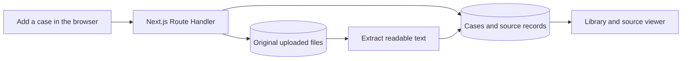

> Multi-document uploads and semantic retrieval extend this original single-source guide. Follow [the current multi-document guide](semantic-retrieval.md) for the 500,000-character source limit, direct storage uploads, per-source retries, and staged indexing. The single-source API remains a compatibility adapter; case details now return metadata and source text loads through the segmented text route.

# Understanding the case library and source ingestion

Rewoven can now store past projects, let you inspect their original documents, and accept new cases. This guide explains that implementation using a small example. Optional [AI-assisted case reading](ai-assisted-case-reading.md) now suggests editable metadata with source evidence. [Conversational queries](conversational-queries.md) now support request comparisons, and [reuse plans](reuse-plans.md) add reviewed requests, editable Markdown, explicit saves, and export.

## Start with a concrete example

Imagine your team built a vendor billing portal. You have delivery notes explaining that finance reviewed invoices and that each approval recorded a reviewer and timestamp.

1. Open **Case library**, then **Add case**.
2. Choose **Paste text** and paste the delivery notes, or select supported source files.
3. Choose **Enter details yourself instead** and enter `Vendor Billing Portal` as the title.
4. Add supported findings under the overview sections. Leave recorded results empty if nobody documented a result.
5. Select the save/add action, then open the new case to inspect its overview and sources.

Rewoven stores the original material, extracts readable text, and prepares that text for keyword search. A successful case becomes **Ready** and appears in the library. You can select it, inspect its text, and open or download the original.

A blank outcome stays **Outcome not recorded**. The application does not invent a success story from the fact that a project exists.

For the loading placeholders and request transitions, see [Understanding loading states and skeletons](loading-states.md).

## Edit or permanently delete a case

Suppose you added **Vendor Billing Portal**, then discovered its recorded outcome needs correcting. Open its case page, select **Edit case**, update the title or overview findings, and select **Save overview**. Your edits remain separate from the original AI draft. A changed finding becomes an unverified contributor note; unchanged findings retain their source references. If another tab saved first, reload the saved overview before trying again.

Editing these details leaves original documents, chunk IDs, and embeddings unchanged. Embeddings describe the original source passages, so changing the title or overview requires no new embedding calls. Replacing or individually removing documents is outside this feature.

To remove the whole project, select **Delete case**. The confirmation names the case and explains what will remain. **Cancel** receives initial keyboard focus. After **Delete permanently**, the app returns to the library and shows the result. A database failure leaves the confirmation open with an error and an enabled retry action. Failed and partially processed cases support the same controls. Shared fictional samples remain read-only on both the page and the API.

### What happens to its embeddings?

Embeddings live in `source_chunks.embedding`, alongside each passage. Both parent relationships already use `ON DELETE CASCADE`:

```text
cases → source_documents → source_chunks (including embeddings)
```

Deleting **Vendor Billing Portal** deletes only its source records, chunks, and vectors. Other projects remain searchable without reindexing. Related case-bound AI readings and reviews also cascade. Session-level analysis caches and embedding-usage accounting are separate from the searchable case corpus.

The server first checks the active demo session and ownership. A database function then records original-file paths, removes the case from current chat selections, and deletes the case in one transaction. A deletion receipt prevents a delayed creation retry from recreating the same case ID. Repeating deletion from the original active session is safe.

Saved answers and plans keep their historical text and quoted excerpts. Their sources become unavailable and receive the existing stale-evidence warnings; deleting a case does **not** erase those snapshots. Stale historical answers are omitted from the model's conversational answer history. New retrieval cannot find the deleted case. Database publication guards also reject answers or generated plans whose evidence disappeared during processing.

If the deleted case was attached to a chat, the remaining attachments stay selected. If the last attachment disappears, the chat shows **Choose cases** and **Search full library** and blocks Send until you explicitly choose a scope. Old turn snapshots retain the selections used when those answers were written. Plans whose original selected cases were deleted need a new draft from a chat with current selections.

### Why uploaded files need another step

Supabase's database and Storage are separate services. The database transaction cannot remove file bytes through the Storage API. After deletion commits, the server attempts that cleanup. If Storage is unavailable, the case stays deleted and the file paths remain in the server-only `case_deletions` table for retry. Receipts deliberately survive removal of the demo session itself.

An already issued [signed upload URL remains usable for two hours](https://supabase.com/docs/reference/javascript/storage-from-createsigneduploadurl). The cleanup record therefore keeps the paths for a final sweep at least **130 minutes after deletion** (or later when an upload reservation requires it), even if the immediate removal succeeded. That sweep removes a file uploaded late using an old URL. Completed cleanup clears the stored paths but retains the minimal case/session receipt for safe retries.

While a case-library page is open, its existing background loop calls the session-authorized `POST /api/cases/cleanup` endpoint at most once every 30 seconds. Successful immediate cleanup schedules the final sweep; failures retry after 30 seconds. Each request handles at most 20 due cases. Closing the browser stops this loop: there is no scheduler in this feature.

For cleanup without an open browser, run:

```bash
bun run db:cleanup-cases
```

The command drains due batches across all sessions using the server credentials in `.env.local`, including expired or removed sessions. Run it again after the final sweep becomes due. It makes no AI calls. For a hosted target, configure that target's server credentials and pass `--project-ref=<configured-project-reference>`; the reference must match `SUPABASE_URL`. Never put real credentials in tracked files. A hosted deployment needs an operator or separately configured scheduler to run maintenance when no browser remains open.

### Important files and verification

- `src/features/cases/edit-overview-dialog.tsx` and `delete-case-dialog.tsx` provide browser interactions; database and Storage credentials stay on the server.
- `src/app/api/cases/[id]/route.ts` serves existing GET/PATCH and the new DELETE operation. DELETE returns `{ deleted: true, cleanupPending: boolean }`; `cleanupPending` includes the scheduled late-upload sweep.
- `src/features/cases/server/deletion.ts` runs the transaction and bounded file cleanup. `scripts/cleanup-cases.ts` calls the same cleanup logic for maintenance.
- `supabase/migrations/202610180003_case_deletion.sql` adds receipts, transactional deletion, recreation protection, and publication guards. Apply it locally with `bun run db:migrate`; ordinary server restarts do not apply migrations.

With local Supabase and the app running, run `bun --env-file=.env.local test ./tests/case-deletion.integration.ts`. Tests cover unchanged embeddings after editing, cascades, another case's isolation, ownership and session checks, read-only samples, repeated deletion, source-processing interruption, saved snapshots, scope recovery, Storage failure, late uploads, and maintenance after session removal. Storage failures and time advancement are simulated; live AI calls are unnecessary.

Use `bun run devx` to start local Supabase and development, then open the printed URL. Stop Next.js with Ctrl+C. To check production locally, stop development, run `bun run build`, then `bun run start`: the production server needs the compiled application produced by the build. The full verification commands remain in the README.

### Search by part of a title or source text

Type `Har` into **Search cases and source text** to find **Harbor Route Planning Pilot**. After a short typing delay, the browser puts the query in `/case-library?q=Har` and requests `/api/cases?q=Har`. The server calls the database's `search_cases` function and returns matching cases.

Search combines case-insensitive literal fragments with English keyword matching across case titles, overview text, and Ready source chunks. Leading and trailing spaces are ignored. For example, `narw` can find a source containing `narwhal`. Punctuation such as `%` and `_` is literal text, not a wildcard. Search still respects demo-session ownership and sample visibility. Non-empty searches include only Ready cases; clearing the search restores all accessible cases, including processing or failed additions.

Apply migration `202610170007_case_library_partial_search.sql` with `bun run db:migrate` when updating an existing local database. Restarting the development server alone does not update database functions. Run `bun --env-file=.env.local test ./tests/library.integration.ts` with the app and local Supabase running to check partial titles, source fragments, and session isolation. This is keyword and fragment search; it does not correct typos or provide semantic matching in the library.

## How the pieces work together

The **browser** handles typing, selection, the dialog, and progress feedback. The **Next.js server** validates requests, checks ownership, and processes documents. **Supabase** supplies two different services: a database for structured records and Storage for uploaded files.



A **Route Handler** is a server function reached through an HTTP address. For example, submitting the dialog sends a `POST` request to `/api/cases`. The server, rather than the browser, talks to Supabase using its secret key.

The workspace page remains a **Server Component**, which provides the page frame and metadata. Interactive components run in the browser because they need event handlers and state. The PDF parser and database credentials stay on the server.

### Why the database has several tables

| Table              | What it remembers                                                            | Why it is separate                                                  |
| ------------------ | ---------------------------------------------------------------------------- | ------------------------------------------------------------------- |
| `demo_sessions`    | A session identifier, token hash, and expiry                                 | Establishes who may access personal additions.                      |
| `cases`            | Title, overview, revision, compatibility fields, and processing status       | Describes the project independently of a particular document.       |
| `source_documents` | Original text or file location, extracted text, pages, warnings, and version | Keeps evidence and its origin available for inspection.             |
| `source_chunks`    | Smaller text pieces, their locations, and search indexes                     | Makes source text searchable while retaining its document and page. |

An uploaded PDF is kept unchanged in the private `case-sources` bucket. Its extracted text is a different representation stored in the database. Pasted text is retained directly in the database instead of creating an uploaded file.

A **chunk** is a piece of text of up to 2,000 characters. PDF chunks stay within their original page and keep that page number. Chunks support PostgreSQL keyword search and the separate semantic indexing flow described in the [retrieval guide](semantic-retrieval.md).

Chunking prefers paragraph breaks and otherwise ends at whitespace so ordinary words stay whole. For example, `narwhal` remains searchable when it crosses character 2,000. Each chunk retains its exact start and end offsets in the unchanged page text. An unbroken token longer than 2,000 characters is still split to respect the chunk limit. The new boundaries apply when a source is processed; existing Ready cases retain their stored chunks until reprocessed.

### What happens after you select Add case

1. Validate the title, optional fields, source format, and input limits.
2. Reserve one case and its source record together, initially **Processing**.
3. Store an uploaded original if the source is a file.
4. Extract text. For PDFs, read embedded text page by page using `unpdf`.
5. Validate the extracted length and record pages without readable text.
6. Save extracted text and chunks, then mark the case **Ready** in one database transaction.

A **transaction** groups database changes so they either finish together or are rolled back. It prevents a case from becoming Ready before its searchable content has been saved.

If extraction fails, the case becomes **Failed** with an explanation. The retained original remains available. **Retry processing** uses the same case and source; it does not create another case. Retrying an image-only PDF will still fail until you provide readable evidence through a new case.

Processing runs within the HTTP request, without a background queue. Each attempt claims a processing token. An active claim cannot be taken over for two minutes; after that, an interrupted attempt can be retried. A token check prevents an older attempt from overwriting a newer result.

The form also sends a stable request identifier. Repeating the same submission after a lost response returns the existing case. Changing the form starts a new submission.

## How demo sessions protect additions

No account is required. The server creates a random token and puts it in an **HttpOnly cookie**, which browser JavaScript cannot read. The database stores a hash of that token, rather than the token itself.

Every library, detail, retry, and original-file request resolves that cookie to an unexpired server-side session. The server decides ownership; an owner ID supplied by the browser has no authority.

Submitting the same request twice at once reuses one case and one original source. Migration `202610150005_case_reservation_conflicts.sql` makes reservation tolerate conflicts on both the case ID and the session/request key, while the API still checks ownership before returning an existing case. The integration suite exercises concurrent reservations directly against local PostgreSQL as well as duplicate HTTP submissions.

Shared fictional samples are visible to everyone and read-only. Your additions are visible only within your browser's demo session. Sessions last 24 hours from creation, and refreshes do not extend that expiry. Tabs in the same browser profile normally share the session; a separate browser profile or private window gets a different one.

**Row Level Security (RLS)** is also enabled in the database. Anonymous and ordinary authenticated database roles have no access to these tables or processing functions. The server's privileged key bypasses RLS, so explicit ownership checks in the server remain essential. Original files are served through an ownership-checked endpoint, without publishing the bucket.

Expiry ends access through the application. It does not currently delete expired database records or uploaded files automatically. Automated data cleanup is not implemented.

## Important files

Read these in this order if you want to follow the implementation:

| File                                                                | What to look for                                                               |
| ------------------------------------------------------------------- | ------------------------------------------------------------------------------ |
| [case-library.tsx](../../src/features/cases/case-library.tsx)       | Loading the session, search results, selection, and processing updates.        |
| [add-case-dialog.tsx](../../src/features/cases/add-case-dialog.tsx) | Form state, file selection/drop, validation, and submission.                   |
| [ingestion.ts](../../src/features/cases/server/ingestion.ts)        | Bounded uploads, original storage, processing claims, and completion/failure.  |
| [extraction.ts](../../src/features/cases/extraction.ts)             | UTF-8 decoding, PDF pages, warnings, and source chunks.                        |
| [repository.ts](../../src/features/cases/server/repository.ts)      | Ownership-scoped reads and keyword search.                                     |
| [session.ts](../../src/features/cases/server/session.ts)            | Cookie creation, expiry checks, and session lookup.                            |
| [source-viewer.tsx](../../src/features/cases/source-viewer.tsx)     | Document tabs, PDF page controls, and original-file links.                     |
| [migrations](../../supabase/migrations/)                            | Tables, access restrictions, indexes, and transactional processing functions.  |
| [seed-cases.ts](../../scripts/seed-cases.ts)                        | Validated local import of nine curated project cases and their original files. |

The HTTP interface is deliberately small:

| Method and address              | Purpose                                         |
| ------------------------------- | ----------------------------------------------- |
| `POST /api/demo-session`        | Reuse an active session or start a new one.     |
| `GET /api/cases?q=approval`     | List accessible cases or search Ready cases.    |
| `GET /api/cases/:id`            | Read a case and its sources.                    |
| `POST /api/cases`               | Add one case from multipart form data.          |
| `POST /api/cases/:id/retry`     | Retry retained evidence on your case.           |
| `GET /api/sources/:id/original` | Open an original PDF or download original text. |

## Run it and try the workflow

From the repository root, with your Docker-compatible runtime running:

```bash
bun install --frozen-lockfile
bun run db:start
bun run db:status
```

For first-time configuration, copy `.env.example` to `.env.local` only if that local file does not exist. Set `SUPABASE_URL` to the local API URL and `SUPABASE_SECRET_KEY` to the local secret key shown by `db:status`. See the [README quick start](../../README.md#quick-start). Keep the secret in `.env.local`, not in browser code.

Then apply the schema and load the examples:

```bash
bun run db:migrate
bun run db:seed
bun run dev
```

`db:migrate` applies pending local migrations without resetting existing data. `db:seed` imports the original files as well as database records, and preserves original/checkpoint identities on reruns and atomically activates the new catalog. This local command deliberately accepts only a local Supabase URL. For the separate, explicitly opted-in Vercel Production import and table-permission repair, follow the [production deployment guide](ci-cd-and-production.md#import-the-fictional-samples-into-production).

Open [the local library](http://localhost:3000/case-library), or use the port printed by Next.js. Try this walkthrough:

1. Search for **Office Purchasing** and open **Office Purchasing Pilot**.
2. Read the pilot scope, then select a citation beside its recorded results.
3. Check the supporting quote and open the delivery-review PDF at physical page 1.
4. Open **Sources** to inspect extracted pages and processing details.
5. Add the manual example described above, then open its dedicated case page.
6. Refresh and inspect the retained original. Use **Edit case** to organize manual findings.
7. Return to the library and search for a distinctive word from the source.
8. Open a private window. It should show nine shared project samples without your addition.

For structured AI review, contributor corrections, and safe sample replacement, read [case overviews](case-overviews.md).

Stop Next.js with **Ctrl+C**. Supabase keeps running; `bun run db:stop` stops it while preserving local data. On later days, `bun run devx` starts Supabase and Next.js together. Reapply migrations after pulling schema changes; startup does not apply pending migrations to an existing database.

### Reset the local demo

For example, after rehearsing Northbank's request, use a fresh database to repeat the demo from its nine historical projects. Stop your running Next.js server with Ctrl+C, start your Docker-compatible runtime, and keep local Supabase credentials configured in `.env.local`. From the project root, run:

```bash
bun devrs
```

The `devrs` script in `package.json` runs these steps in order: start Supabase, run `supabase db reset --local`, provision the configured storage buckets, run the existing `db:seed` importer, and start `dev`. Each step must succeed before the next starts. Reset reapplies the checked-in migrations and SQL seed; `db:seed` separately restores the nine fictional cases and their 27 original documents using the existing local-only import guard.

**Existing local cases, chats, saved plans, and embeddings are deleted.** Sample import makes no AI calls. The app can use keyword retrieval immediately; regenerate semantic embeddings separately with `bun run db:backfill --embed` when needed (billable OpenAI calls). Resetting the local database does not reset the hosted deployment. `bun run devx` remains the data-preserving startup command.

Open the URL printed by Next.js, usually `http://localhost:3000`, and check that Case library contains nine fictional projects. Browser history may still contain links to deleted chats or plans; start a new chat. Stop Next.js with Ctrl+C; `bun run db:stop` stops the background database while preserving the newly seeded data.

To inspect the production build, use:

```bash
bun run build
bun run start --port 3001
```

The build prepares the optimized application; `start` serves that output. Open [the production-mode local library](http://localhost:3001/case-library). No AI key is needed for this feature.

### Input limits and recovery

| Situation                              | What to do                                                           |
| -------------------------------------- | -------------------------------------------------------------------- |
| Unsupported file                       | Use UTF-8 `.txt`/`.md`, embedded-text `.pdf`, or paste text.         |
| File above 5 MB                        | Choose a smaller file. The application limit is 5,000,000 bytes.     |
| More than 500,000 extracted characters | Split the document. Rewoven does not truncate it silently.           |
| Scanned or image-only PDF              | Provide a text-based PDF or paste the content; OCR is not included.  |
| Password-protected/corrupt PDF         | Export an unlocked, valid text-based PDF or paste the text.          |
| Some PDF pages contain no text         | Read the page warnings; images on those pages are unavailable.       |
| Storage not configured or unavailable  | Check `.env.local`, start Supabase, apply migrations, and try again. |
| Request fails while adding             | The form stays available. Retry without retyping the evidence.       |
| Processing was interrupted             | After two minutes, use **Retry processing** on the retained case.    |

A title is required and limited to 200 characters. Context, outcome, and lessons are optional, each limited to 5,000 characters. The current interface accepts multiple documents, including later additions; the original multipart API remains a single-source compatibility adapter. Uploaded originals and pasted source material remain version 1; editing, replacing, or deleting evidence is not exposed in this interface.

## Verification and current limits

Run focused tests and the repository checks:

```bash
bun run test
bun run lint
bun run format:check
bun run typecheck
bun run build
```

With Supabase configured, seeded, and Next.js running, also run:

```bash
bun run test:integration
```

The integration command defaults to port 3000. To test the production server above:

```bash
TEST_BASE_URL=http://localhost:3001 bun run test:integration
```

The integration suite creates its own sessions and removes their records and uploaded files afterward. It uses local server credentials to simulate expiry and interrupted processing. Run it against your configured local Supabase environment.

Verified locally on 15 October 2026:

- Unit tests cover validation, UTF-8 handling, PDF page extraction, empty pages, encrypted/corrupt/over-limit PDFs, chunk locations, paragraph boundaries, keywords spanning the old chunk boundary, and session tokens/expiry.
- The live API suite covers persistence, duplicate submissions, keyword search, failed/active/interrupted processing, expired sessions, sample protection, cross-session access, and anonymous database/storage denial. It passed against development and production servers.
- Browser checks cover paste, native file selection, drag-and-drop, PDF pages, failed extraction/retry, source switching, refresh persistence, source search, dialog focus/Escape, and form preservation after a simulated server failure.
- Light/dark themes, reduced motion, and widths of 390px and 320px were checked. Formatting, lint, type checking, and production compilation passed.

The deliberately simulated 503 appeared in the browser console as expected. Chromium also logged a transient `aria-hidden` focus warning during rapid dialog reopening; explicit initial-focus and focus-restoration checks passed. A screen-reader audit has not been performed.

This is a locally verified feature, not a verified hosted deployment. Hosted migrations, seed provisioning, upload limits, and runtime behavior still need deployment-specific verification. There is no OCR, reuse-plan persistence, automatic expiry cleanup, or source editing. [Conversational queries](conversational-queries.md) now support cited request-to-case comparisons and case Q&A. Semantic retrieval is implemented in the linked current guide. Optional [AI-assisted case reading](ai-assisted-case-reading.md) is implemented as a separate follow-up increment.
