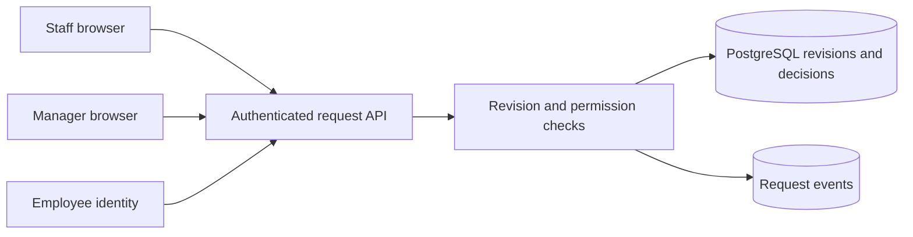

# Office Purchasing Pilot - Implementation notes

Fictional demonstration material. All organizations, people, events, and results are invented.

**Delivery company:** Threadline Delivery  
**Client:** Meadow Office Services (fictional)  
**Project:** Office Purchasing Pilot  
**Period:** January 2026  
**Status:** Delivered limited pilot  
**Document version:** 2

## Decision and rationale

Approval was bound to a request revision rather than a mutable request row. A transaction inserted the decision and changed state only when the submitted revision still matched the manager's screen. A stale manager screen received a conflict and had to reload. The design deliberately kept rejected and superseded revisions rather than overwriting their item lists.

## Technical behavior

The tables were purchase_request, request_revision, approval_decision, and request_event. Each revision kept a calculated total in integer VND. The server recalculated it from submitted line items rather than trusting a browser total. Request events identified the actor, revision, old state, new state, and server timestamp. The database transaction prevented a state update from succeeding without its corresponding decision record.

## Worked example

Request PO-014 asked for four chairs. A manager opened revision 2, then the requester increased the quantity to six, creating revision 3. Approving revision 2 returned a revision conflict. The manager reloaded and approved revision 3. The history showed both the amendment and the later approval, making it possible for the administrator to explain which list was authorized.

## Verification scope

Acceptance checks exercised manager approval, self-approval rejection, an edit after approval, and a stale manager screen. The approved request could not remain approved after its quantity changed. These were scripted functional checks using fictional employee accounts and a single office. No test exercised multiple branches or a second finance decision, because those behaviors had not been built.

## Handover material

The handover included the transition checklist, revision-conflict example, database relationship sketch, and acceptance notes. An engineer can use these records to understand the design, but this document pack contains no application source code or drop-in library. Any reuse still requires implementation, integration with current sign-in, and tests against the new client's approval rules.

## How to read the engineering reconstruction

The following diagrams, API contracts, SQL, and pseudocode deepen this fictional history. They are explanatory reconstructions, not runnable application source or independently executed tests. Proposed work stays prospective; the delivery review defines the recorded outcome. External technical references support patterns, never proof of Threadline delivery.

## Office Purchasing Pilot: Architecture: one transaction owns an approval

In this fictional Office Purchasing pilot, a Next.js browser form called a server API backed by PostgreSQL. Employee sign-in supplied a verified subject; the server resolved that subject to the requester or assigned manager. The browser never supplied authoritative actor identity. The application had no purchasing integration or payment worker. An administrator recorded a manual purchase reference only after approval, as a separate activity.



The revision, approval decision, state change, and event were database concerns. A UI banner could explain that an approval was superseded, but could not determine whether an edited request remained authorized. The server returned the latest revision and effective decision together so the screen did not join an old approval to new line items accidentally. The diagram is an explanatory reconstruction of the fictional design, not an exported deployment inventory.

## Office Purchasing Pilot: Data model and invariants

For Office Purchasing, `purchase_request` held the stable request identity, requester, assigned manager, current revision number, and current state. `request_revision` held an immutable item snapshot, reason, calculated total, author, and creation timestamp. Its unique key was `(request_id, revision_number)`. `approval_decision` referenced that exact pair, the manager, decision, and server time. `request_event` recorded the transition and revision. This prevents an approval from being associated with an unspecified version of a mutable list.

The illustrative schema fragment below shows relationships rather than a complete migration. It omits identity tables and some indexes. Decisions referenced an existing revision; the service also checked authority and state inside the transition transaction. A foreign key by itself does not prove that the manager was authorized.

```sql
CREATE TABLE request_revision (
  request_id uuid NOT NULL REFERENCES purchase_request(id),
  revision_number integer NOT NULL CHECK (revision_number > 0),
  items jsonb NOT NULL,
  total_vnd bigint NOT NULL CHECK (total_vnd >= 0),
  PRIMARY KEY (request_id, revision_number)
);
-- approval_decision uses a composite foreign key to this revision.
```

The fictional pilot accepted whole-VND unit prices and positive integer quantities. The API rejected fractional quantities and negative prices, recomputed totals using integer arithmetic, and rejected totals outside the database integer range before committing. It did not trust a displayed browser sum. These pilot rules do not supply a future client's tax policy: tax-inclusive routing and rounding need their own definition. Database constraints protected stored shape; application checks explained validation failures to users.

## Office Purchasing Pilot: State transitions and command contract

Office Purchasing used `draft`, `awaiting_manager`, `approved`, and `rejected`. Submit created the first submitted revision and entered manager review. An amendment to submitted content created a new immutable revision and returned to manager review, including after approval. Rejection required a reason. Historical decisions remained visible but only a decision for the current revision could authorize the current request. Deleting an old decision was unnecessary and would remove useful explanation.

An illustrative command was `POST /purchase-requests/PO-014/decisions` with `{ "expectedRevision": 3, "decision": "approve" }`. The server obtained the manager from sign-in. Success returned the request ID, revision 3, and `approved`. An obsolete revision returned `409 revision_conflict`; missing authority returned `403`. These are documented example contracts, not live endpoints in Rewoven. The caller had to reload and review the changed items before sending a new decision.

```typescript
// Illustrative service pseudocode; all calls use the same transaction.
await transaction(async (tx) => {
  const request = await tx.lockRequest(requestId);
  await requireAssignedManager(tx, actor, request);
  requireDifferentPeople(actor, request.requesterId);
  requireState(request, "awaiting_manager");
  requireRevision(request, input.expectedRevision);
  await tx.insertDecision(request.id, request.revision, actor, "approve");
  await tx.setState(request.id, "approved");
  await tx.insertEvent(request.id, request.revision, actor, "approved");
});
```

The lock was held for a short server transaction, never while a human reviewed a screen. Amendment and approval acquired the same request lock before checking revision and state. If the decision write or event insertion failed, the transaction rolled back its state change as well. Server authorization remained necessary even if the button was hidden. A transaction did not independently prevent duplicate request creation; that is the separate Expense Reimbursement lesson.

## Office Purchasing Pilot: Worked trace: approving the current chair request

The fictional fixture PO-014 began with four chairs at VND 900,000 each. Revision 2 therefore recorded VND 3,600,000. The requester changed the quantity to six; the server created revision 3 for VND 5,400,000, advanced `current_revision`, and recorded an amendment event. The API response identified revision 3 as awaiting manager review. No part of the earlier approval could remain effective for the new quantity.

The manager then loaded revision 3, checked six chairs and the recalculated total, and approved that version. The transaction inserted a decision for `(PO-014, 3)`, changed the current state to approved, and appended the event. The administrator could now record a manual purchase reference. That reference was not proof of delivery or payment. The UI showed revision 2's decision under history, explicitly labelled superseded, rather than beside the current authorized quantity.

## Office Purchasing Pilot: Failure trace: approval races with amendment

The original fictional screen defect showed an old approval beside an amended list. Reproduction used two browsers: the manager opened revision 2, while the requester saved revision 3. Sending the manager's old command afterwards had to fail. The server compared `expectedRevision = 2` with the locked request's revision 3, returned the conflict, and inserted neither an effective approval nor a successful approval event. The manager saw a reload message explaining that the requested items had changed.

If approval obtained the lock first, revision 2 could be approved before the amendment. The subsequent amendment still created revision 3 and invalidated that authorization. Both orderings ended with no effective approval for unreviewed revision 3. This distinction matters: serializing commands does not mean the earlier decision never existed. It means the final state and preserved history agree. A second identical approval command was rejected as a state conflict, not documented as a replay-safe operation.

## Office Purchasing Pilot: Acceptance, operations, and reuse boundary

The fictional acceptance record covered approval, self-approval rejection, amendment after approval, and stale-screen rejection. A useful regression matrix exercises both race orderings, verifies one consistent final state, and checks that every accepted transition has its matching event. Injecting an event-write failure should leave no approved state. Those additional scenarios are a handoff test design, not a claim that this repository contains or executes the pilot application.

Operationally, support needed the request ID, revision, actor, and correlation ID to distinguish a conflict from an outage. Business errors were not retried blindly. A short database deadlock retry could repeat the whole transaction only after rollback; it could not bypass permissions or accept a stale revision. No latency objective, production capacity, recovery time, or approval-time saving was established. Export and retention decisions remained outside this narrow pilot.

The reusable unit is the revision-bound transition pattern, not a finished approval package. A future multi-stage purchasing project would need its own routing policy, decision actors, current authorization rules, and submission-retry contract. Adding a `finance_approved` Boolean would hide stage ordering and revision identity. The expansion proposal explores policy versions but does not prove that multi-stage purchasing was delivered.

## Office Purchasing Pilot: Technical references and evidence status

- [PostgreSQL explicit locking](https://www.postgresql.org/docs/current/explicit-locking.html) explains row locks, blocking, and deadlocks; it supports the short transaction design, not a performance guarantee.
- [PostgreSQL transaction isolation](https://www.postgresql.org/docs/current/transaction-iso.html) explains concurrent updates and transaction snapshots. All command participants must follow the locking or conditional-write discipline.
- [RFC 9110 If-Match](https://www.rfc-editor.org/rfc/rfc9110.html#name-if-match) describes an alternative HTTP precondition mechanism. This example uses an explicit revision and 409; it does not claim to implement ETags.

All fixture identifiers, incidents, and acceptance outcomes above are fictional. SQL, pseudocode, and diagrams are explanatory reconstructions, not tested production source code or external evidence of delivery.
