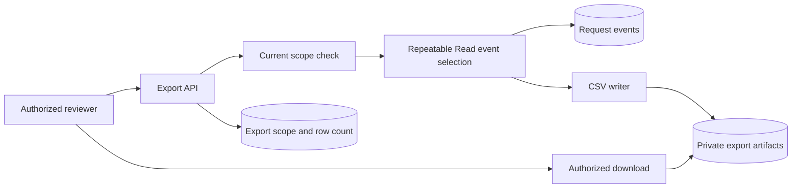

# Audit Export Dashboard - Implementation notes

Fictional demonstration material. All organizations, people, events, and results are invented.

**Delivery company:** Threadline Delivery  
**Client:** Finch Service Operations (fictional)  
**Project:** Audit Export Dashboard  
**Period:** April 2026  
**Status:** Delivered operational review export  
**Document version:** 2

## Decision and rationale

Application users could append new events through normal state transitions but could not edit or delete earlier events through the dashboard. Corrections were new events referencing the earlier record. The team deliberately used append-only at the application layer rather than claiming that this design alone established immutable infrastructure or formal compliance.

## Technical behavior

An event contained event_id, record_id, revision, actor_id, action, previous_state, next_state, and occurred_at. The export job also stored its requesting reviewer, scope, cutoff, and count. Access filtering applied before export. For text that began with spreadsheet formula characters, the CSV writer emitted a safe text representation so exported notes could not become active spreadsheet formulas.

## Worked example

A reviewer exported one team's request history through the recorded cutoff. A later approval created a new event but did not change the already generated file. A correction to a request reason appeared as a later correction event rather than rewriting the original event. Another team's records were absent because the reviewer did not have access to that scope.

## Verification scope

Acceptance checks compared exported rows with the selected scope and cutoff, checked actor and revision fields, tested a later event, and opened hostile-looking cell text as text. These were functional checks of the pilot exporter. They did not assess external audit standards, disaster recovery, long-term retention, or privileged-administrator tampering.

## Handover material

The retained material is an event-field checklist, cutoff example, export permission check, and safe-cell test. A future team can use these to design an explainable request history. It still needs agreement on who may export, which sensitive fields are excluded, how long records are retained, and how large exports should be delivered.

## How to read the engineering reconstruction

The following diagrams, API contracts, SQL, and pseudocode deepen this fictional history. They are explanatory reconstructions, not runnable application source or independently executed tests. Proposed work stays prospective; the delivery review defines the recorded outcome. External technical references support patterns, never proof of Threadline delivery.

## Audit Export Dashboard: Architecture: a consistent selection becomes an export artifact

The fictional Audit Export dashboard joined request events with authorized review scope. Its browser called an authenticated export API backed by PostgreSQL and private file storage. The pilot ran small exports synchronously; it had no durable queue or background-job guarantee. The service selected an authorized event set inside one consistent database snapshot, created CSV, stored the artifact privately, and recorded its scope and row count. Downloads required authorization again.



The API distinguished requested, generating, ready, and failed states. Ready meant that the artifact existed and metadata was recorded, not that every business event was truthful or that retention met a legal standard. Original events remained append-only through application commands, while corrections were new events. Privileged database administrators could still modify data; this pilot did not establish a tamper-proof ledger or formal compliance.

## Audit Export Dashboard: Event and export models

Audit Export used `request_event` with event ID, request ID, revision, actor, action, previous state, next state, server time, and correlation ID. A correction referenced an earlier event without replacing it. `export_record` stored the requesting actor, authorized scope, requested time range, generated cutoff, selected row count, state, and private object path. Scope and time range travelled with the artifact so a reviewer could explain why an event was included or excluded.

```sql
-- Illustrative event fields, not a complete application migration.
CREATE TABLE request_event (
  id uuid PRIMARY KEY,
  request_id uuid NOT NULL,
  revision integer NOT NULL,
  actor_id uuid NOT NULL,
  action text NOT NULL,
  occurred_at timestamptz NOT NULL,
  correlation_id uuid NOT NULL
);
```

The business transition and its event were committed in the same transaction. The dashboard could not recover a missing business event merely by logging that someone opened the page. Access-denied diagnostics were separate from accepted transition history. Sensitive credentials, raw receipt contents, and signed download URLs were excluded from event payloads. A server timestamp described when the service recorded an action; it was not proof of an external action's true occurrence time.

## Audit Export Dashboard: Correcting the inconsistent export defect

The fictional early exporter fetched pages with independent live queries. While page one was being written, another user approved a request. Later pages could therefore describe a different database state, and offset pagination could skip or repeat rows. Recording a cutoff improved explainability but was not sufficient by itself: a transaction that started earlier could commit later with an earlier event timestamp. An event ID is not automatically a commit-order watermark either.

The reconstructed repair selected the authorized event set under a single Read Only Repeatable Read transaction and stable `(occurred_at, id)` ordering. The service recorded the cutoff and materialized the selected rows in memory before closing that transaction, then generated the small pilot artifact. Later commits could not change that selected set. The cutoff was a visible time boundary; the snapshot established database consistency. The service did not keep a transaction open while a user downloaded a file.

```sql
BEGIN ISOLATION LEVEL REPEATABLE READ READ ONLY;
SELECT id, request_id, revision, actor_id, action, occurred_at
FROM request_event
WHERE team_id = ANY($1) AND occurred_at >= $2 AND occurred_at < $3
ORDER BY occurred_at, id;
COMMIT;
-- $1 is the server-authorized team set, not an unchecked browser scope.
```

## Audit Export Dashboard: API example and artifact lifecycle

An illustrative `POST /event-exports` accepted `{ "teamIds": ["T-02"], "from": "2026-04-01T00:00:00Z", "to": "2026-05-01T00:00:00Z" }`. The server validated the range, intersected requested scope with current permission, and rejected an unauthorized scope rather than silently expanding it. Completion returned an export ID, scope, cutoff, row count, and status. `GET /event-exports/EX-12/download` rechecked permission before issuing a short-lived private download URL. These routes are examples, not Rewoven endpoints.

Database metadata and object storage could not commit atomically. If upload failed, the record stayed failed and no ready link was issued. If upload succeeded but the metadata write failed, support could identify the orphan from its export-specific path. Retry created a newly identified artifact or resumed an explicitly tracked unfinished export; it did not overwrite a previously issued file. Automatic orphan cleanup and retention duration were not established. Expired links could be reissued only after authorization.

## Audit Export Dashboard: Worked trace: scope, cutoff, and a later correction

Fictional reviewer R-06 exported team T-02's events for April. The snapshot selected the eligible rows, and EX-12 recorded that exact row count and cutoff. A purchase approval committed after selection; it did not appear in EX-12 even if its originating transaction had begun earlier. A later export could include it. The original artifact remained unchanged. This was a stable snapshot of authorized recorded events, not a promise that all organizational activity had been captured.

An incorrect request reason was corrected through a later event referencing the earlier record. An export covering both times showed the original and correction rather than a rewritten past. Another team's rows were absent because R-06 lacked access. If R-06's assignment was removed before requesting a new download, authorization denied a new link. An already-issued bearer URL could remain usable until expiry; the pilot made no instantaneous download revocation claim.

## Audit Export Dashboard: Failure trace: spreadsheet formulas in user text

A fictional note began with `=HYPERLINK(...)`. Ordinary CSV quoting protects commas, quotes, and newlines, but spreadsheets can still evaluate a quoted cell as a formula. The pilot's spreadsheet export treated all untrusted text cells as text using a leading apostrophe and correct CSV escaping. Numeric fields came from validated numeric values, not raw user strings. The file's intended consumer was the spreadsheet workflow checked during pilot review.

This encoding changed the exported text representation. It was not a universal interchange format or a guarantee for every spreadsheet product. A consumer requiring byte-exact text would need a separate explicitly designed machine-readable export. The acceptance fixture included formula prefixes, leading whitespace, tabs, commas, quotes, and embedded newlines. The fictional review's hostile-cell check did not establish a security certification or compatibility matrix for every application.

## Audit Export Dashboard: Acceptance, operations, and reuse

The fictional delivered checks compared selected scope, row count, revision/actor fields, later events, corrections, and hostile-looking cells. Additional handoff tests should include a late-committing older transaction, a download after assignment revocation, artifact upload failure, and stable ordering of equal timestamps. Those are proposed verification scenarios. Large-export capacity, crash recovery across process restarts, disaster recovery, and long-term retention were not measured or delivered.

The synchronous design deliberately matched a small pilot. A future large-export service would need a bounded snapshot/materialization strategy, durable jobs, retry-safe storage, and a permission decision at download time. Long-running database snapshots can retain old row versions and increase database pressure; adding a queue does not automatically solve consistency. a future client can reuse event provenance, stable artifact metadata, and explicit export scope, while choosing its own field privacy, retention, and capacity rules.

## Audit Export Dashboard: Technical references and evidence status

- [PostgreSQL Repeatable Read](https://www.postgresql.org/docs/current/transaction-iso.html) explains a stable transaction snapshot; a timestamp predicate alone is not that snapshot.
- [OWASP logging guidance](https://cheatsheetseries.owasp.org/cheatsheets/Logging_Cheat_Sheet.html) supports recording when, where, who, and what without indiscriminate sensitive data collection.
- [OWASP CSV injection](https://owasp.org/www-community/attacks/CSV_Injection) explains why CSV quoting and spreadsheet formula handling are different concerns.

All export identities, incidents, checks, and outcomes are fictional. The schema and query are explanatory; no compliance, tamper resistance, or universal spreadsheet-safety guarantee is established.
