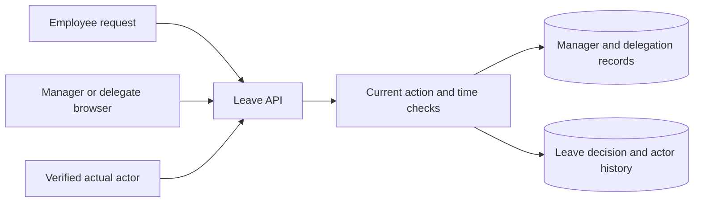

# Staff Leave Approval Tool - Implementation notes

Fictional demonstration material. All organizations, people, events, and results are invented.

**Delivery company:** Threadline Delivery  
**Client:** Lark Studio (fictional)  
**Project:** Staff Leave Approval Tool  
**Period:** April 2026  
**Status:** Delivered manager delegation pilot  
**Document version:** 2

## Decision and rationale

A delegation was an explicit record with principal manager, delegate, allowed action, start, and expiry. The server evaluated it when approving, rather than caching a permanent delegate flag in the browser. Approval history recorded the actual actor and the principal. A delegate could not create another delegation to an additional person.

## Technical behavior

The request stored its assigned manager. A decision referenced either that manager acting directly or a valid delegation record. The UI displayed acting for only when a decision actually used delegation. After expiry, old decisions remained visible as history, but new writes required another current assignment. This separated historical explanation from current authority.

## Worked example

Manager M-03 delegated leave review to colleague D-02 for an agreed week. D-02 approved a leave request during that window, and the history retained both identities. A request sent after expiry could still be read by an otherwise authorized user, but D-02's attempted approval was denied unless a new delegation had been registered.

## Verification scope

Controlled checks covered an active delegation, expiry before approval, a forged manager identifier, and an attempt to delegate onward. The correct acting and represented identities appeared in accepted decisions. The tests did not include financial limits, branch purchasing authority, or an automated organization-directory integration, and they did not measure employee scheduling outcomes.

## Handover material

The handover included an assignment example, expiry tests, and actor-display rules. A future client should first decide whether delegation is allowed and whether the delegate may perform the same action or only review it. The existence of this project is a reason to ask that question, not a reason to add delegation silently to another project's first release.

## How to read the engineering reconstruction

The following diagrams, API contracts, SQL, and pseudocode deepen this fictional history. They are explanatory reconstructions, not runnable application source or independently executed tests. Proposed work stays prospective; the delivery review defines the recorded outcome. External technical references support patterns, never proof of Threadline delivery.

## Staff Leave Approval Tool: Architecture: delegated action without shared credentials

The fictional Staff Leave tool used an employee browser, existing sign-in, an authenticated review API, and PostgreSQL. The server resolved the actual signed-in employee for every decision. An administrator maintained manager assignments and temporary delegations. A delegate used their own account; the application did not share the manager's credentials or rewrite the actor as the manager. The request's assigned manager and current delegation determined authority at execution time.



The pilot had one managerial review stage. It did not calculate payroll, approve spending, synchronize an organization directory, or define staffing entitlements. Delegated leave review was a specific action, not an administrator role. A reviewer who could approve leave did not inherit the manager's other permissions. The diagram reconstructs the fictional system's responsibilities rather than representing deployed infrastructure.

## Staff Leave Approval Tool: Data model and time boundary

Staff Leave used `leave_request`, `manager_assignment`, `delegation`, `leave_decision`, and `leave_event`. A delegation stored its principal manager, actual delegate, allowed action, start, expiry, creator, and optional revocation time. A decision stored the actual actor, represented manager, and delegation ID if used. A direct manager decision had no delegation reference. Historical decisions retained those identities after expiry or revocation; current authority was evaluated separately.

```sql
CREATE TABLE delegation (
  id uuid PRIMARY KEY,
  principal_id uuid NOT NULL,
  delegate_id uuid NOT NULL,
  allowed_action text NOT NULL,
  starts_at timestamptz NOT NULL,
  expires_at timestamptz NOT NULL,
  revoked_at timestamptz,
  CHECK (principal_id <> delegate_id),
  CHECK (expires_at > starts_at)
);
```

The illustrative time contract was half-open: `starts_at <= decision_time < expires_at`. Exactly at expiry the delegation no longer authorized a new decision. The server clock supplied `decision_time` immediately before validation, after relevant locks were acquired, rather than accepting browser time. This was an authorization-time boundary; an action authorized just before expiry could commit just afterwards. A different requirement about commit time would need another design.

## Staff Leave Approval Tool: Review command and revocation ordering

An illustrative `POST /leave-requests/LV-28/decision` carried `{ "decision": "approve", "expectedRevision": 1 }`. The API resolved the actor from sign-in and the principal from the request's current manager assignment. A delegate could not choose an unrelated principal in the payload. The service required an active action-specific delegation, disallowed self-approval, checked request state/version, and recorded decision plus event in one transaction. These are example contracts, not routes served by Rewoven.

```typescript
// Illustrative transaction; revocation locks the same delegation row.
await transaction(async (tx) => {
  const request = await tx.lockLeaveRequest(requestId);
  const principal = await tx.currentManager(request.employeeId);
  const delegation =
    actor.id === principal.id
      ? null
      : await tx.lockDelegation(principal.id, actor.id, "review_leave");
  requireAuthorityAtServerTime(actor, principal, delegation);
  requireNotSelfApproval(actor, request);
  requirePendingRevision(request, expectedRevision);
  await tx.recordDecision(request, actor, principal, delegation, decision);
  await tx.appendLeaveEvent(request.id, actor.id, principal.id, decision);
});
```

For delegated decisions, revocation and approval used the same delegation-row lock. If revocation committed first, approval observed it and failed. If approval checked valid authority first, revocation waited and the accepted historical action remained recorded. Manager reassignment likewise needed synchronized authority checks in an adaptation. An action that had already completed was not retroactively erased by a later revocation. The service avoided external calls while holding locks and used consistent lock ordering.

## Staff Leave Approval Tool: Worked trace: an active one-week assignment

In the fictional fixture, manager M-03 delegated `review_leave` to D-02 from Monday 09:00 to the following Monday 09:00 in the agreed office time zone, stored as UTC instants. Request LV-28 belonged to an employee whose manager was M-03. On Wednesday, D-02 signed in using their own account and approved revision 1. The server checked the active window and action and recorded actor D-02, principal M-03, and the delegation ID.

The history displayed “D-02 acting for M-03” and retained the event time. When M-03 returned, they could inspect that history without the system falsely attributing the click to them. The employee saw the decision and actual reviewer. This demonstrated traceability for a fictional leave workflow. It did not demonstrate whether the approval improved staffing outcomes or whether a future client permits delegation for financial decisions.

## Staff Leave Approval Tool: Failure trace: expiry while the screen remains open

D-02 opened a pending leave request shortly before delegation expired and clicked approve afterwards. The browser still showed the button, but the API compared current server time against the delegation window and denied the decision. No approved state or success event was committed. The UI explained that the temporary authority had ended and offered reload. Keeping a browser tab open did not extend the assignment; changing the browser clock did not affect the check.

Another fixture attempted to pass M-99 as the represented manager. The server resolved M-03 from the request rather than trusting that parameter, and found no applicable authority for the forged combination. An attempt by D-02 to delegate onwards to D-09 was denied because only the administrator's registration workflow could create assignments. A valid delegation record could not recursively create authority. Reading old decisions did not itself authorize new writes.

## Staff Leave Approval Tool: Defect and repair: the history hid the actual actor

The fictional early history screen displayed only the principal manager. That made a delegated decision look as if M-03 had personally acted. The repair retained both actor and principal in the decision and changed the label to expose delegation. The event also kept its delegation reference, allowing support to inspect the authorization that existed at decision time. The repair was about honest attribution, not granting more permissions.

Expiry and revocation affected future commands while leaving completed decisions intact. A correction or reversal required a separate authorized action with its own event. The application did not rewrite old actor fields after a directory rename. A future design might snapshot display names for explanation while retaining stable identity IDs, subject to privacy and retention decisions. That was an adaptation question, not evidence that every historical identity problem had been solved.

## Staff Leave Approval Tool: Acceptance, operations, and transfer to purchasing

The fictional pilot recorded active-delegation, expired-delegation, forged-principal, and onward-delegation checks. A handoff matrix adds exact start/expiry instants, revocation racing approval, requester acting as delegate, missing current manager, and a failed event write. Expected results include no unauthorized decision, rollback of partial state, and accurate actor/principal history. These additional tests are design guidance rather than claims of executable test coverage in this repository.

Administrators needed ownership of the manager map and delegation registrations. Support needed request ID, actual actor, principal, assignment ID, decision time, and denial reason without exposing credentials. Delegation registrations used explicit instants to avoid ambiguous local-time parsing. No directory sync, automatic absence detection, throughput measurement, staffing benefit, or long-term audit retention was established. If no authorized reviewer existed, the request remained pending rather than silently escalating to anyone available.

A future client must first decide whether delegation is allowed at all. If so, distinguish manager review from finance review, prevent the delegate from bypassing separation of duties, and decide whether authority is branch- or amount-limited. Reusing the leave tool's Boolean “active delegate” without action and resource checks would be insufficient. The transferable pattern is explicit, bounded, attributable authority; financial policy is new work.

## Staff Leave Approval Tool: Technical references and evidence status

- [OWASP authorization guidance](https://cheatsheetseries.owasp.org/cheatsheets/Authorization_Cheat_Sheet.html) supports action-specific checks on every request. The delegation schema and half-open window are design applications, not a prescribed OWASP implementation.
- [PostgreSQL explicit locking](https://www.postgresql.org/docs/current/explicit-locking.html) explains synchronization and lock ordering for decisions and revocations.
- [OWASP logging guidance](https://cheatsheetseries.owasp.org/cheatsheets/Logging_Cheat_Sheet.html) supports retaining the identity and context of the actual action.

All people, windows, incidents, and outcomes are fictional. The schema and pseudocode explain a design; they are not a runnable leave service or evidence of spending authority.
