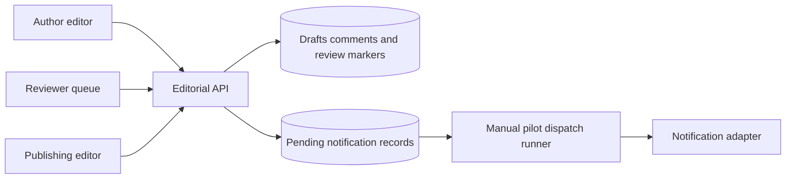

# Marketing Content Approval Tool - Implementation notes

Fictional demonstration material. All organizations, people, events, and results are invented.

**Delivery company:** Threadline Delivery  
**Client:** Paperplane Media (fictional)  
**Project:** Marketing Content Approval Tool  
**Period:** May 2026  
**Status:** Delivered editorial review workflow  
**Document version:** 2

## Decision and rationale

The client chose editable drafts and lightweight review markers. A notification linked to the current draft, and the editor checked final text before scheduling. The team explicitly declined a revision-locked sign-off because that was not the agreed editorial workflow. This choice was suitable for the stated pilot but was never validated for authorization of money or goods.

## Technical behavior

The model held content_draft, comment, review_marker, and notification. Notifications identified the work item and reason without including a complete draft in email. The current draft remained mutable; review_marker did not contain a complete approved text snapshot. Reviewer assignment was editorial and did not encode financial separation of duties or a purchase amount.

## Worked example

An author submitted a campaign headline, received a wording comment, and changed the copy while review was still open. The reviewer marked the draft reviewed, and the editor later adjusted punctuation before scheduling publication. The tool retained the activity, but it did not ask for another review after that final edit under the client's agreed workflow.

## Verification scope

The pilot checks covered comment creation, a review-queue notification, access for assigned editors, and a scheduled item appearing in the editor's list. The team did not run tests for immutable approved amounts, duplicate purchase submission, two-stage financial review, or finance identity. Those guarantees cannot be inferred from successful editorial tests.

## Handover material

The team retained notification copy, review-queue states, and the discussion explaining mutable drafts. These are useful records of an editorial product. A new team should inspect them to understand both possible reuse and mismatch, instead of selecting this implementation solely because its title contains the word approval.

## How to read the engineering reconstruction

The following diagrams, API contracts, SQL, and pseudocode deepen this fictional history. They are explanatory reconstructions, not runnable application source or independently executed tests. Proposed work stays prospective; the delivery review defines the recorded outcome. External technical references support patterns, never proof of Threadline delivery.

## Marketing Content Approval Tool: Architecture: a collaborative queue rather than financial authority

The fictional Marketing Content tool used a browser editor, an authenticated server API, PostgreSQL, and a notification adapter. Authors edited current drafts, reviewers commented and marked work reviewed, and editors scheduled publication. The design deliberately allowed copy changes during editorial review. A review marker recorded editorial progress; it was not an immutable signature over every character. No component calculated purchase totals or granted a right to spend money.



The notification runner was an operator-invoked pilot process over pending rows, not a continuously managed queue service or a production delivery guarantee. Scheduling stored an intended publication time and status for the editor's workflow. The pilot did not include a complete external publishing integration. Being present in a schedule list did not prove that content had been published anywhere. These distinctions preserve what the fictional delivery review actually claims.

## Marketing Content Approval Tool: Data model and mutability choice

Marketing Content used `content_draft`, `comment`, `review_marker`, `schedule_entry`, and `notification`. A draft held current title/body, editorial state, owner, and an edit version for avoiding accidental lost updates. Comments referenced the draft, author, and timestamp. Review markers stored reviewer and time but no immutable approved snapshot. Schedule entries identified the draft, editor, planned time, and status. Editing a draft incremented its edit version without automatically invalidating the lightweight reviewed marker.

```sql
-- Illustrative optimistic edit; this protects text from lost updates.
UPDATE content_draft
SET body = $1, edit_version = edit_version + 1
WHERE id = $2 AND edit_version = $3
RETURNING edit_version;
-- Zero rows means stale editing state; reload before resubmitting.
```

An edit version and an approval revision are different concepts. Here, edit version prevented two browser saves from silently overwriting each other. It did not bind editorial permission to immutable final content or reset review after punctuation changes. A financial workflow needs explicit rules about which changes invalidate authorization. Copying this update statement into purchasing would not supply those rules, stage ordering, or separate financial actors.

## Marketing Content Approval Tool: Command contracts and notification boundary

An illustrative `PATCH /content-drafts/CD-19` included an expected edit version and updated text. `POST /content-drafts/CD-19/comments` created a comment. `POST /content-drafts/CD-19/review-marker` recorded an editorial review. `POST /content-drafts/CD-19/schedule` stored the editor's selected publication time after checking assignment and state. These are fictional service contracts, not live Rewoven endpoints. The editor remained responsible for checking the final current copy.

Creating a review-queue notification was committed alongside the editorial action as a pending notification row. Its payload contained the draft ID, recipient, reason, and event ID; it did not copy the full draft into email. A uniqueness key on editorial event and recipient avoided creating duplicate pending notifications for the same recorded event. The dispatch runner retried failed sends using the same notification identity. Successful local bookkeeping did not prove the email provider delivered exactly once.

```typescript
// Illustrative pilot dispatch, with an at-least-once external boundary.
const notice = await claimPendingNotification();
try {
  await provider.send({ recipient: notice.recipient, draftId: notice.draftId });
  await markSent(notice.id);
} catch (error) {
  await recordAttemptFailure(notice.id, safeErrorCode(error));
}
// A crash after provider acceptance but before markSent may duplicate delivery.
```

The runner's claim needed an expiring lease so a crashed attempt could be recovered. The fictional handoff did not establish an automated production scheduler, provider deduplication contract, or notification latency. An operator could rerun pending work; the work queue remained the reliable place to see review tasks even if email was late. Notifications were advisory links, not authority tokens. Opening a link still required current draft access.

## Marketing Content Approval Tool: Worked trace: author, reviewer, editor

In fictional draft CD-19, an author submitted a campaign headline for review. A reviewer commented that the wording overstated the offer. The author corrected the current draft while review was open. The reviewer then marked the item reviewed. An editor later changed punctuation, checked the final copy, and created a schedule entry. The reviewed marker remained by design because the client chose flexible editorial progress rather than immutable sign-off.

The queue showed the new review task even if its notification had not yet been dispatched. Email contained a short reason and a link, not confidential draft contents. Access was evaluated when following that link. The editor's schedule list showed CD-19 and its planned time. None of these actions was evidence of a supplier order, approved expenditure, guaranteed publication, or completed external delivery. The example is intentionally a tempting partial match for purchasing.

## Marketing Content Approval Tool: Failure trace: reviewed is mistaken for financially approved

The fictional handover defect was a label: a stakeholder used “approved” for a reviewed draft. Another reader could infer that later changes were blocked or reapproved. The team changed the language to reviewed and documented that current text remained mutable. It did not retrofit a revision-locked financial decision engine. Historical activity still explained who commented, reviewed, and scheduled. A wording correction could not create guarantees that the underlying data model did not provide.

For a new financial workflow requiring revision-bound approvals, copying this review marker would allow an amount to change while the old marker stayed visible. That would violate that new workflow's authorization rule. The useful reuse is a work queue, comment trail, notification identity, and access-checked deep link. The required replacement is a financial transition model bound to request revisions and policy, with distinct decision actors and server-calculated totals.

## Marketing Content Approval Tool: Failure trace: email acknowledgement is uncertain

In the illustrative dispatch failure, the provider accepted a notification and the runner crashed before updating `sent_at`. On retry, the same pending row could be sent again because the provider did not offer a verified deduplication guarantee in this record. A database uniqueness constraint prevented duplicate outbox rows, but not every duplicate external email. The operator retained attempt history and the user still saw only one underlying review task. The example illustrates a boundary, not a repaired production incident with measured results.

The design avoided treating email receipt as completion of review. An expired lease allowed another attempt; a maximum-attempt decision and escalation procedure were operational questions for a production adaptation. A draft deleted or reassigned before dispatch needed another permission/content check. Sensitive full content stayed out of payloads and logs. There was no guaranteed provider delivery time, external publication retry contract, or offline collaborative editing feature.

## Marketing Content Approval Tool: Acceptance, operations, and reuse

The fictional delivery review records comments, review notifications, assigned editor access, and scheduling-list behavior. Handoff tests add a stale edit version, failed notification dispatch, crash after provider acceptance, and an unauthorized deep link. Keep expected outcomes separate: text conflicts do not overwrite another editor, a queue task persists without email, and unauthorized users cannot open drafts. Those additional checks are prospective examples, not tests executed against an included editorial application.

The modular boundaries were editorial commands, notification creation, and external dispatch. They reduced coupling between saving a comment and a slow provider, while adding pending-work administration. A small synchronous email call would be simpler but could lose notification intent after the draft transaction committed. The chosen pilot record illustrates that tradeoff without claiming production-grade background processing. a future client should decide whether notifications are required and whether email duplication is tolerable before adopting the pattern.

## Marketing Content Approval Tool: Technical references and evidence status

- [PostgreSQL transaction isolation](https://www.postgresql.org/docs/current/transaction-iso.html) supports conditional updates and transactional creation of related records.
- [PostgreSQL explicit locking](https://www.postgresql.org/docs/current/explicit-locking.html) explains row coordination for dispatch claims. A lock alone does not bridge the provider/database transaction boundary.
- [OWASP authorization guidance](https://cheatsheetseries.owasp.org/cheatsheets/Authorization_Cheat_Sheet.html) supports checking access when notification links are followed.

All drafts, organizations, incidents, and delivery outcomes are fictional. SQL and dispatch pseudocode explain patterns and limitations; they are not a finished notification library, publishing service, or financial authorization component.
