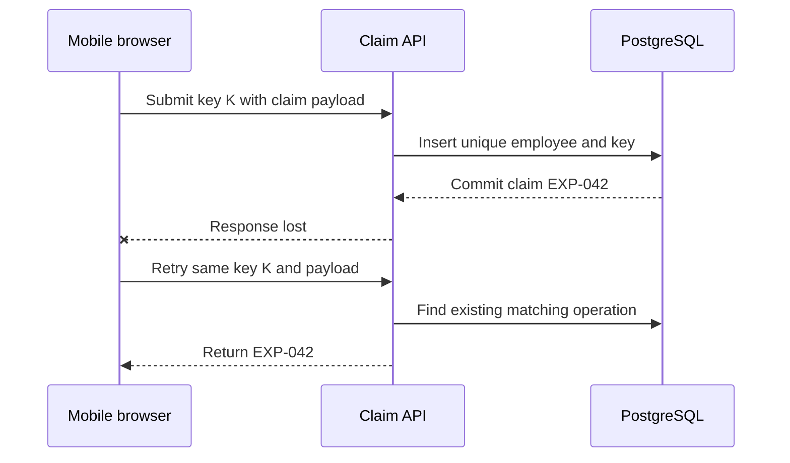

## Architecture: durable identity for a logical submission

In the fictional Expense Reimbursement portal, the mobile browser called an authenticated claim API backed by PostgreSQL. A logical submission could produce several HTTP attempts, but only one claim. The browser generated an operation key once when submitting a completed form, retained the normalized form and key across a timeout, and asked the API to recover the result. Payroll reimbursement was a separate human process. There was no bank API, payment worker, or promise of exactly-once payment.



The acknowledgement was allowed to fail independently of the database commit. The API therefore could not use receipt of an HTTP response as evidence that a claim existed or did not exist. The stable key connected the repeated attempts. Disabling Send reduced accidental clicks, but a second tab or a network retry still required database enforcement. This diagram reconstructs the invented incident; it is not a captured production trace.

## Record model and uniqueness boundary

For Expense Reimbursement, `expense_claim` stored the claim ID, employee ID, operation key, normalized payload fingerprint, amount, currency, receipt reference, and current review state. A unique constraint covered `(employee_id, operation_key)`. Employee scope came from verified sign-in, never from a client-selected employee ID. A claim event recorded initial creation; replaying the result did not create another business submission event. Attempt-level diagnostics used a separate correlation ID for each HTTP request.

```sql
CREATE UNIQUE INDEX expense_claim_operation
  ON expense_claim(employee_id, operation_key);
-- The claim, operation key, and payload fingerprint are committed together.
-- A receipt business identifier is a separate concern from this index.
```

The fingerprint was calculated on validated server-normalized fields in a defined order, including amount, currency, reason, and receipt reference. It excluded transient browser metadata. Currency was fixed for the pilot; integer amounts prevented serialization differences such as `1000` versus `1000.0` from accidentally becoming different operations. Fingerprint comparison protected against reusing one key for an edited submission. It did not determine whether two independently keyed claims described the same real receipt.

## API contract and transaction behavior

An illustrative `POST /expense-claims` carried `Idempotency-Key: K-EXP-042` and `{ "amountVnd": 850000, "reason": "Client visit", "receiptRef": "R-18" }`. Creation returned `201` with EXP-042. A matching retry returned `200` with EXP-042 and its current state. A changed amount under K-EXP-042 returned `409 operation_payload_conflict`. Invalid input returned `422` before consuming the key. These statuses describe the fictional contract, not an endpoint implemented by Rewoven.

```typescript
// Illustrative pseudocode: use two statements in a Read Committed transaction.
await transaction(async (tx) => {
  const created = await tx.insertClaimOnConflictDoNothing(
    employeeId,
    operationKey,
    normalizedPayload,
    fingerprint,
  );
  if (created) {
    await tx.insertClaimEvent(created.id, employeeId, "submitted");
    return created;
  }
  const existing = await tx.findClaim(employeeId, operationKey);
  if (!existing || existing.fingerprint !== fingerprint)
    throw payloadConflict();
  return existing;
});
```

The insert used `ON CONFLICT DO NOTHING`; catching a uniqueness error and then querying in the same aborted PostgreSQL transaction would not work. Under Read Committed, the following SELECT obtained a fresh statement snapshot after a conflicting committed insert. The claim rows were not deleted during the pilot. If a future retention policy could delete them concurrently, the recovery contract and handling of a missing winner would need revision. Repeatable Read or Serializable would require their own whole-transaction retry handling.

## Worked trace: commit succeeds, acknowledgement disappears

The fictional employee E-18 submitted VND 850,000 under K-EXP-042. Validation normalized the receipt reference and calculated fingerprint F1. PostgreSQL committed EXP-042, its operation key, and one submitted event. A test proxy then dropped the response. The browser showed an uncertain state rather than asserting that submission had failed. It retained the same key and form payload for the recovery attempt.

On reconnect, the API authenticated E-18 and attempted the same insert. The unique constraint selected the existing operation. The server loaded EXP-042, compared F1, and returned that claim ID. The browser navigated to the recorded claim and cleared the pending operation only after confirmation. A newly intended claim received a new key. Reload recovery in this pilot used same-tab session storage for the pending key and minimal normalized form, cleared on confirmation or sign-out; it was not a durable offline queue or a cross-device guarantee.

## Failure traces: concurrent retries and changed payload

For concurrent identical submissions, requests A and B used the same employee/key pair. One transaction inserted the row; the other waited for the uniqueness conflict to resolve. If A committed, B read A's row and returned its ID. If A rolled back, B could insert instead. The losing request did not insert a second submitted event. A timeout while waiting left the client uncertain and safe to retry with the same key; it did not justify inventing another key automatically.

For a conflicting payload, E-18 changed the amount to VND 950,000 after a timeout but kept K-EXP-042. The server found F1 and compared it with F2, returned a conflict, and preserved the original claim unchanged. The UI explained that an operation had already been recorded with different details. The employee had to inspect EXP-042 and deliberately choose an amendment workflow or a genuinely new claim. Silent merging would erase what the first operation actually recorded.

Another failure boundary was support lookup. Knowing a key did not authorize another employee to read the claim; the API always scoped lookup to the authenticated employee or an explicitly authorized reviewer. Keys were not secret access tokens. Receipt files had separate access rules. Logs did not contain complete receipt contents or personal authentication credentials. These details prevent a retry mechanism from accidentally becoming a data-disclosure endpoint.

## Acceptance and operational decisions

The fictional repaired pilot's recorded checks covered lost response after commit, simultaneous identical attempts, and payload conflict. The handoff adds expected scenarios for a failed transaction, an unauthorized employee, validation before insertion, and a repeated request after the reviewer changes claim state. A replay returned the current claim state, not an immutable copy of the original HTTP response. This differs from providers that retain the original response body and status.

During the pilot, keys remained attached to retained claims and were not reused. No long-term retention duration or archival procedure was established. Support could search by employee, operation key, and claim ID to resolve uncertainty. A timeout count was useful operational telemetry, but no production failure rate or availability result was recorded. An external side effect would require its own durable dispatch and deduplication design; committing a claim is not proof that an email or payment happened once.

For a future client, adapt the pattern to creating one purchase request and its initial revision. Decide which fields define an identical submission, preserve the key while the result is uncertain, and return the existing authorized request. Use revision checks separately for later amendments and decisions. Neither safeguard substitutes for the other. Intentionally submitting the same receipt or purchase twice with different keys remains a business detection problem.

## Technical references and evidence status

- [PostgreSQL constraints](https://www.postgresql.org/docs/current/ddl-constraints.html) supports enforcing uniqueness in the database rather than a pre-insert existence check.
- [PostgreSQL Read Committed](https://www.postgresql.org/docs/current/transaction-iso.html) explains why the follow-up statement can see a committed conflicting row. The pseudocode's isolation assumption is deliberate.
- [Stripe idempotent requests](https://docs.stripe.com/api/idempotent_requests) is a real example of operation keys and parameter consistency. Stripe's retention, error replay, and concurrency contract are provider-specific and are not claimed for this fictional portal.

All fixtures and acceptance outcomes are invented. The sequence, SQL, and service pseudocode explain a design; they are not a runnable reimbursement service or evidence that Rewoven itself sends claims.
