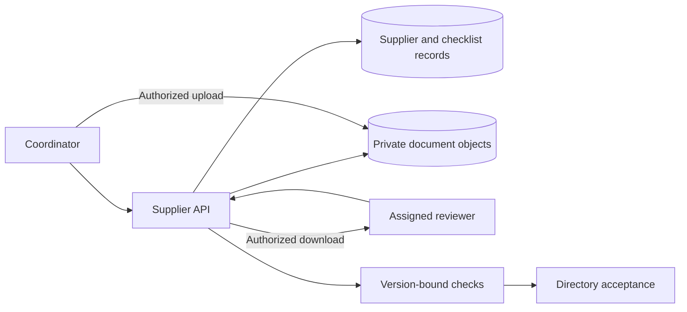

## Architecture: evidence storage and review are separate

The fictional Supplier Onboarding workspace used an authenticated web application, PostgreSQL review records, and a private object bucket. A coordinator requested an upload target; the server checked assignment and issued a short-lived upload authorization for a new random object path. Completing a browser upload did not mark a supplier reviewed. A server completion step checked the expected object and created a document-version record. Reviewers obtained separately authorized download links.



The private bucket held bytes, while the database determined which bytes were currently under review. Object paths were generated per version and were never overwritten through the application. This was application-managed versioning, not a claim that the object service provided S3 Versioning. The pilot did not include malware scanning or automated due diligence. Its acceptance result meant that required human checks were complete, not that supplier documents were trustworthy.

## Data relationships and checklist versions

Supplier Onboarding used `supplier`, `checklist_definition`, `required_document`, `supplier_document_version`, and `document_check`. A supplier had a stable ID independent of its display name. Required items belonged to a numbered checklist definition. A document version referenced its supplier, required item, private object path, byte count, and upload completion time. A check referenced the exact version, reviewer, result, and reviewed time. Only a check of the currently selected version satisfied an active required item.

```sql
-- Illustrative relationship fragment, not a full deployable schema.
CREATE TABLE document_check (
  id uuid PRIMARY KEY,
  document_version_id uuid NOT NULL REFERENCES supplier_document_version(id),
  reviewer_id uuid NOT NULL,
  result text NOT NULL CHECK (result IN ('accepted', 'needs_replacement')),
  reviewed_at timestamptz NOT NULL
);
```

Whether every required document had passed was a cross-row rule evaluated by the service inside the acceptance transaction. It was not implemented as a `CHECK` constraint that queried other rows. The supplier row was the synchronization point for replacing a current version, completing review, or accepting the supplier. Those commands locked the same supplier row, then rechecked assignments and active versions. This prevented acceptance from racing with a replacement that invalidated the last required check.

## Upload and review API examples

An illustrative `POST /suppliers/SUP-031/uploads` identified a required item and expected supplier revision. The response contained a new document-version ID and an expiring upload URL. The browser uploaded to that target and called `POST /supplier-documents/DV-07/complete`. Completion verified that the object existed with the recorded size before exposing it to review. The UI displayed `uploaded`, not `accepted`. The API did not treat a browser's claimed success flag as proof that bytes existed.

For a review command, `POST /suppliers/SUP-031/checks` carried `{ "documentVersionId": "DV-07", "result": "accepted" }`. Actor identity came from sign-in. The service checked assignment, current document version, readable object metadata, and current supplier state. A stale version returned a conflict; an unassigned reviewer was denied. A subsequent accept command evaluated the complete active checklist. These are illustrative contracts, not Rewoven API routes.

```typescript
// Illustrative acceptance transaction.
await transaction(async (tx) => {
  const supplier = await tx.lockSupplier(supplierId);
  await requireDirectoryAdministrator(tx, actor, supplier);
  const required = await tx.activeRequiredItems(supplier.checklistVersion);
  const checks = await tx.currentVersionChecks(supplier.id);
  requireEveryRequiredItemAccepted(required, checks);
  await tx.acceptSupplier(supplier.id, supplier.checklistVersion, actor);
  await tx.appendSupplierEvent(supplier.id, actor, "directory_accepted");
});
```

## Worked trace: completing a missing attachment

In the fictional SUP-031 fixture, contact details were present but the required registration attachment was absent. The supplier stayed in collecting documents. The coordinator uploaded DV-07 to a new private path and confirmed completion. The assigned reviewer opened the original file and recorded an accepted check against DV-07. The acceptance transaction found a current accepted check for every item in checklist version 2 and moved SUP-031 to accepted for the internal directory.

The directory exposed SUP-031, its display name, checklist version, and acceptance state. A downstream purchase form could use that stable supplier ID for lookup, but still needed its own purchasing permissions. Directory acceptance did not approve a request, authenticate bank details, or guarantee commercial suitability. The registration example organized a fictional client's internal checklist; it made no claim about legal validation of a business registration.

## Failure trace: replacing a reviewed document

Later, a coordinator replaced DV-07 with DV-08. The replacement command locked SUP-031, selected DV-08 as current, and reopened the affected review item. The old check still referred to DV-07 and stayed available in history. It could no longer satisfy the active checklist. The supplier's current acceptance state returned to under review until the new version was checked. The original object was retained rather than silently replaced under the same path.

A reviewer who had left DV-07 open could not submit another check as if it applied to DV-08. The API compared the version under lock and returned a conflict with the current version identifier. If acceptance and replacement arrived together, their shared lock serialized them: replacement either blocked acceptance until review, or reopened review immediately after an earlier acceptance. The final directory state could not claim the unchecked current document was reviewed.

## Failure trace: upload completes outside the business transaction

Object storage and PostgreSQL were not one atomic transaction. A file could upload successfully while the completion request failed. The client retried completion using the document-version ID; completion was safe to repeat and did not create a second selected version. An uploaded-but-unconfirmed object stayed outside the review queue. Conversely, missing object metadata prevented completion from becoming ready. The UI offered retry or an explicit replacement rather than assuming that every failure required another upload.

An operator could inspect pending upload records and their expected paths. Orphan cleanup was a manual handoff procedure for this fictional pilot, using pending records and a review period; no automatic cleanup or retention guarantee was delivered. The notes did not invent a guaranteed object lifetime. Signed download URLs were bearer links until expiry. Assignment revocation blocked issuing another link, but did not retroactively invalidate every already-issued link.

## Acceptance, tradeoffs, and reuse

The fictional delivery review records missing-item blocking, successful checklist completion, replacement invalidation, and denial of an unassigned reviewer. Additional handoff tests cover concurrent replacement/acceptance, completion retry, missing object, and an expired download link. These are expected test designs beyond the narrow recorded checks. No throughput result, document-content verification, malware result, or reduction in onboarding effort was measured.

The design kept checklist versions stable for an active review. A new required-item policy created a new definition; deciding when existing suppliers needed re-review was an administrator's business decision, not an invisible migration. Review ownership and checklist maintenance were explicit handoff responsibilities. Support diagnostics used supplier ID, document version, and command correlation ID without logging document contents or signed URLs.

For a new purchasing pilot, reuse stable identifiers and version-bound evidence checks if supplier records are actually required. Do not add the entire onboarding workflow merely because purchasing mentions suppliers. Confirm who supplies the directory, who owns required checks, and whether acceptance can expire. The reusable pattern concerns collecting and reviewing evidence; spending authority remains elsewhere.

## Technical references and evidence status

- [Supabase private buckets](https://supabase.com/docs/guides/storage/buckets/fundamentals) explains authorized downloads and signed URLs. Private paths alone do not establish application permissions.
- [PostgreSQL constraints](https://www.postgresql.org/docs/current/ddl-constraints.html) explains foreign keys and the limitations of cross-row checks.
- [OWASP authorization guidance](https://cheatsheetseries.owasp.org/cheatsheets/Authorization_Cheat_Sheet.html) supports checking permissions for every operation, including download authorization.

Names, incidents, review records, and outcomes are fictional. The diagram and pseudocode are educational reconstructions, not an executable supplier service or proof of compliance.
