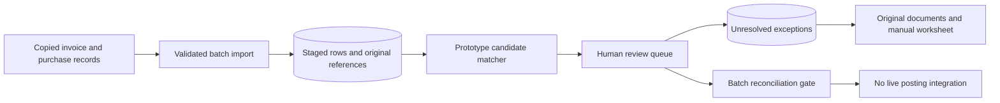

## Architecture of the failed trial

The fictional Invoice Matching pilot used a web import screen, PostgreSQL staging tables, a matching service, and an operator review queue. It ran against copied records without live posting credentials. A batch owned the imported rows and their provenance. Matching produced suggestions, not accounting entries. A reviewer could accept or reject a suggestion, while unresolved items prevented the batch from being marked reconciled. The existing manual worksheet was the fallback outside the matching tool.



This architecture explains the failed pilot; it must not be read as a validated matching engine. The initial algorithm normalized supplier display names and purchase references, then selected an apparently suitable candidate. That was insufficient when names were ambiguous or references were reused. Preserving a review queue limited downstream damage, but did not establish matching accuracy. Completing the manual process after stopping the trial did not turn the automation into a successful release.

## Trial data and provenance

Invoice Matching retained `import_batch`, `imported_invoice`, `match_suggestion`, `match_review`, and `reconciliation_exception`. An imported invoice kept its source filename, row number, raw reference, normalized reference, supplier display name, and amount. A suggestion linked an invoice to a purchase candidate with a rule explanation. Review decisions recorded actor and time. Exceptions retained the rejected suggestion and reason; they were not overwritten by a later candidate.

```sql
-- Illustrative trial relationship, not a complete migration.
CREATE TABLE match_suggestion (
  id uuid PRIMARY KEY,
  invoice_id uuid NOT NULL REFERENCES imported_invoice(id),
  candidate_purchase_id uuid NOT NULL,
  rule_used text NOT NULL,
  review_state text NOT NULL
    CHECK (review_state IN ('pending', 'accepted', 'rejected'))
);
```

Import identity was separate from a business invoice identifier. Repeating a file import needed a deliberate batch decision; matching on invoice amount alone could not identify a duplicate business document. The trial notes did not establish a production import deduplication policy. A future implementation would need stable source identifiers or a defined file/row fingerprint strategy and a correction flow for supplier-issued revisions. Those are proposed improvements, not repairs completed during this pilot.

## What the matching rule actually did

The prototype stripped spacing and normalized case in reference strings, looked for a matching normalized purchase reference, and used a similar supplier name to choose a candidate. It did not have a reliable supplier identifier across the copied datasets. Where several purchases shared a reference, the first candidate could appear plausible even when it represented another delivery. A populated `candidate_purchase_id` therefore meant only that a heuristic had selected a row.

An illustrative `POST /invoice-batches/B-03/suggestions` triggered the trial matcher. `GET /invoice-batches/B-03/exceptions` showed unresolved items. A reviewer command identified the suggestion, expected review version, decision, and explanation. These examples describe the trial's responsibilities rather than live Rewoven endpoints. No endpoint posted to the accounting system, and no status implied payment. Review actions were distinct from approval of an office purchasing request.

## Worked success path: explainable human resolution

A fictional invoice INV-201 referenced a unique purchase and a complete recorded delivery. The operator compared the original invoice, purchase revision, and received quantities, then accepted the suggestion with a note. The tool retained the invoice-to-purchase link and the human decision. This was a successful review action inside a failed batch trial, not a measured algorithm result. A single correct match could not compensate for unresolved errors elsewhere in the batch.

After the pilot stop decision, operators used original documents and the manual worksheet to account for invoices. The manual reconciliation record identified which source material was checked and which reviewer completed the task. That allowed the business cycle to finish. It did not demonstrate that the prototype had become accurate, that manual effort fell, or that an automated posting interface existed. The corrected delivery review deliberately preserves those distinctions.

## Failure trace: wrong supplier and reused purchase reference

In the fictional failure fixture, an invoice used the trading name “Copper Supplies” while copied purchase data contained two similar directory names. Reference PO-77 had also been reused for separate deliveries. The matcher chose the first candidate and attached a purchase whose delivery did not belong to the invoice. An operator opening the original documents found the discrepancy before external posting. The suggestion was rejected and the invoice remained unresolved.

The exception retained the invoice, conflicting purchase candidates, raw references, reviewer note, and reason `ambiguous_supplier_and_reference`. The batch reconciliation gate remained blocked. The stop owner paused the automation and invoked manual fallback. Changing the UI label from unresolved to matched would not repair the underlying identity problem. Nor would selecting the highest arbitrary confidence score create evidence that the candidate was correct.

## Proposed replacement design, never implemented here

The postmortem proposed stable supplier IDs, explicit purchase revisions, and receipt line references. A future pipeline would first validate identity, then generate all plausible candidates, then compare invoice quantities and amounts against a defined receiving basis. Ambiguity, missing records, partial deliveries, tax differences, and freight differences would become typed exceptions. Only a business-approved tolerance policy could define when an exception was acceptable. The pilot never implemented or validated this replacement.

```typescript
// Proposed pseudocode only: not the failed trial's delivered algorithm.
const supplier = resolveStableSupplierId(invoice);
if (!supplier) return exception("unknown_supplier");
const candidates = findPurchases(supplier.id, invoice.purchaseReference);
if (candidates.length !== 1) return exception("ambiguous_purchase");
const comparison = compareReceivedLines(invoice, candidates[0]);
if (!comparison.withinAgreedPolicy) return exception(comparison.reason);
return humanReviewCandidate(candidates[0], comparison);
```

For example, an invoice for ten units with only six recorded as received should not automatically close a purchase. A proposed review screen would show ordered, received, previously invoiced, and newly invoiced quantities separately. The client still needed to decide whether partial invoicing was permitted and who could accept a difference. No numeric tolerance, automatic override, or success rate should be invented to complete the diagram.

## Release gate, rollback, and operations

The fictional trial's stop condition was unresolved matching error in the reviewed batch before any external posting. The team retained the imported rows and suggestions for diagnosis instead of deleting the failed evidence. The rollback procedure disabled trial use, identified unresolved invoices, handed the original materials to operators, and reconciled the manual worksheet. An early “cycle completed” release note was corrected to say that the cycle completed manually after the automation failed.

A future handoff test matrix would contain duplicate references, supplier aliases, missing purchases, partial receipts, tax/freight differences, and a concurrent reviewer update. It would compare outputs against independently reviewed ground truth. Accuracy and coverage would be reported separately; a matcher that abstains on every invoice cannot claim useful automation merely because it makes no false matches. These evaluation suggestions are prospective. The trial recorded neither a repaired algorithm passing them nor measured production capacity.

Support needed batch ID, source row, candidate IDs, rule version, reviewer decision, and stop reason. Credentials for external posting stayed absent. If a future version adds posting, it needs a separate authorized transition and retry contract after reconciliation. Purchase approval, goods receipt, reconciliation, accounting posting, and payment are distinct business events. a future client can reuse exception handling and release-stop discipline, but cannot reuse a finished matching engine from this archive.

## Technical references and evidence status

- [PostgreSQL constraints](https://www.postgresql.org/docs/current/ddl-constraints.html) supports stable relationships and uniqueness where business identity is defined. A foreign key does not prove that an invoice was matched to the correct business purchase.
- [OWASP logging guidance](https://cheatsheetseries.owasp.org/cheatsheets/Logging_Cheat_Sheet.html) supports recording who acted, what happened, and enough context to investigate a failed operation without exposing sensitive contents.

All batch examples and incidents are fictional. Corrective architecture and pseudocode are explicitly proposed, not implemented or acceptance-tested results. No automatic accounting or payment success is established.
