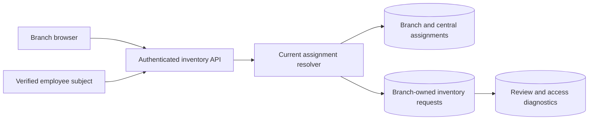

## Architecture: permission checks around every resource

The fictional Branch Inventory portal used existing employee sign-in, a server API, and PostgreSQL. Inventory requests belonged to a branch. Staff had current branch assignments; explicitly assigned central reviewers could inspect across branches. The browser's branch selector helped users navigate but was not an authorization boundary. List, detail, amendment, review, and download operations each resolved the signed-in identity and checked current assignments on the server.



The pilot concerned stock-transfer requests. It did not authorize purchases from suppliers, reserve physical stock, or implement a full warehouse ledger. A central review assignment was an explicit capability, not a conclusion inferred from an employee's job title. Server-side checks did not establish that the assignment data was correct; an administrator still owned that data. No automatic organization-directory synchronization was delivered.

## Data model and policy

Branch Inventory used `employee`, `branch`, `branch_assignment`, `central_review_assignment`, `inventory_request`, and `inventory_request_event`. A branch assignment related an employee to a branch and allowed action. The request stored its own immutable branch ownership for the pilot. A requester with several active assignments had to choose one authorized branch during creation. Subsequent detail checks used the stored branch, not a query parameter or a browser's last-selected branch.

```sql
-- Illustrative policy query for reading a request.
SELECT r.* FROM inventory_request r
WHERE r.id = $1 AND (
  EXISTS (SELECT 1 FROM branch_assignment a
    WHERE a.employee_id = $2 AND a.branch_id = r.branch_id AND a.active)
  OR EXISTS (SELECT 1 FROM central_review_assignment c
    WHERE c.employee_id = $2 AND c.active)
);
```

Read and review permissions were separate. A branch requester could inspect local records but did not automatically gain the lead's review action. A central reviewer could perform only the actions in the explicit assignment. The schematic query shows resource scoping; a production implementation needs appropriate indexes, identity mapping, and action-specific predicates. It does not imply that all central staff can edit every request or that this SQL alone supplies a complete policy engine.

## API contracts and server execution

An illustrative `GET /inventory-requests?branchId=BR-02` intersected the requested filter with the employee's permitted branches. It never treated the supplied branch as permission. `GET /inventory-requests/IR-104` resolved IR-104's stored branch before returning it. An unauthorized detail request returned the same not-found response used for an absent request, avoiding disclosure of another branch's record. Diagnostic logs retained the denial for authorized support investigation.

For creation, `POST /inventory-requests` carried `{ "branchId": "BR-02", "items": [{ "sku": "CHAIR-A", "quantity": 4 }] }`. The server checked membership, validated the item list, and stored BR-02 with the request. For review, a command included the expected request revision. The server loaded the request, checked review permission against its branch, checked state/revision, and recorded the decision plus event together. These are documented fictional interfaces, not live Rewoven APIs.

```typescript
// Illustrative action authorization; actor comes from verified sign-in.
await transaction(async (tx) => {
  const request = await tx.lockInventoryRequest(requestId);
  await tx.lockAssignmentAuthority(actor.id);
  await requireCurrentPermission(tx, actor, "review", request.branchId);
  requireRevision(request, expectedRevision);
  await tx.recordReview(request.id, actor.id, decision);
  await tx.appendEvent(request.id, actor.id, "reviewed");
});
```

In this reconstructed design, assignment changes and protected writes synchronized on an authority row for the affected employee. All review writes acquired resource then authority locks in that order; assignment maintenance acquired the authority lock without request locks. This gave revocation a defined transaction ordering. An action that committed before revocation remained historical; one checking authority after revocation was denied. Merely reading membership once at page load would not provide that property.

## Worked trace: local request and explicit central review

Fictional employee E-22 belonged to BR-02 and created IR-104 for four stock chairs. The server resolved E-22, checked BR-02 membership, stored the request's branch, and returned the authorized record. A BR-02 lead reviewed IR-104 under the current action permission. Employee C-01 had a separately recorded central-review assignment and could inspect BR-02 as well as other branches within that assignment. The event retained C-01 as the actor; the system did not impersonate a local manager.

For an employee assigned to both BR-01 and BR-02, the form required an explicit selection. Choosing BR-02 created a BR-02 request even if the previous screen had shown BR-01. Support could explain ownership from the stored record and creation event. Moving an existing request between branches was outside the pilot; changing a browser filter could not transfer ownership. A future transfer function would need a defined permission check and event rather than an unrestricted branch edit.

## Failure trace: direct links and forged branch IDs

The fictional defect reproduction copied an IR-104 detail link from a BR-02 account into a BR-01-only account. A client-only list filter would hide IR-104 in normal navigation but still leak it through that direct link. The corrected server query scoped the resource using current assignments and returned not found. The same employee then changed the list query and submission body to BR-02; the server denied creation and returned no cross-branch records. Hiding the selector was not the repair.

Another test opened IR-104 while E-22 was authorized, then revoked E-22's assignment before a review command. The server checked authority again at execution, so a stale browser screen did not grant continuing permission. The UI could still contain previously viewed information; revocation prevented new server access, not erasure from a person's memory or already-downloaded data. Long-lived cached permission flags were deliberately avoided. Browser identity claims never replaced the assignment table.

## Acceptance, operations, and limitations

The fictional delivered checks covered own-branch access, cross-branch direct links, forged branch IDs, and explicitly assigned central review. The engineering handoff adds expected scenarios for revocation between read/write, multiple assignments, a lead without central authority, and simultaneous revocation/review. These describe the policy boundaries to verify if adapting the pattern. They are not claims of production penetration testing, universal isolation, or measured performance.

Assignment updates required an authorized administrator, a reason, and an event. A stale organization import could therefore be diagnosed without granting a requester central privilege as a shortcut. Logs used actor ID, requested action, resource ID, branch, and correlation ID; the public error avoided revealing another branch's contents. The pilot established no recovery-time objective, capacity limit, directory sync guarantee, or inventory accuracy result. Correct access checks do not prove that physical stock quantities are correct.

For a future client, reuse current-assignment resource checks but replace inventory actions with purchasing actions. Central finance permission must be explicit and must not bypass stage order, revision matching, self-approval prevention, or distinct manager/finance actor rules. A user can be allowed to read a request without being authorized to approve it. Decide who maintains assignments and what happens when the assigned manager leaves. Do not infer a procurement hierarchy from this stock-transfer pilot.

## Technical references and evidence status

- [OWASP authorization guidance](https://cheatsheetseries.owasp.org/cheatsheets/Authorization_Cheat_Sheet.html) recommends default denial and permission validation on every request, including guessed resource identifiers.
- [PostgreSQL explicit locking](https://www.postgresql.org/docs/current/explicit-locking.html) explains synchronization, lock ordering, and deadlock risks. The example authority-row protocol is a design application, not an OWASP-mandated schema.

All identities, branches, incidents, and acceptance outcomes are fictional. Queries and pseudocode reconstruct the design and are not an executable inventory service or proof of financial authorization.
