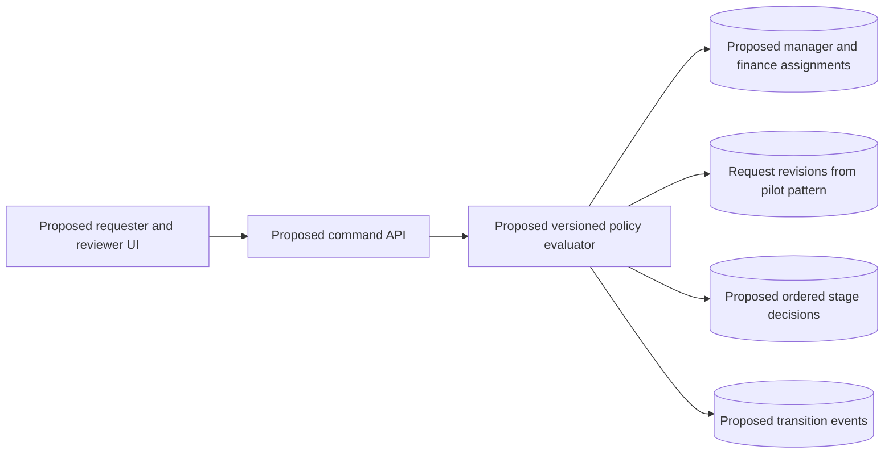
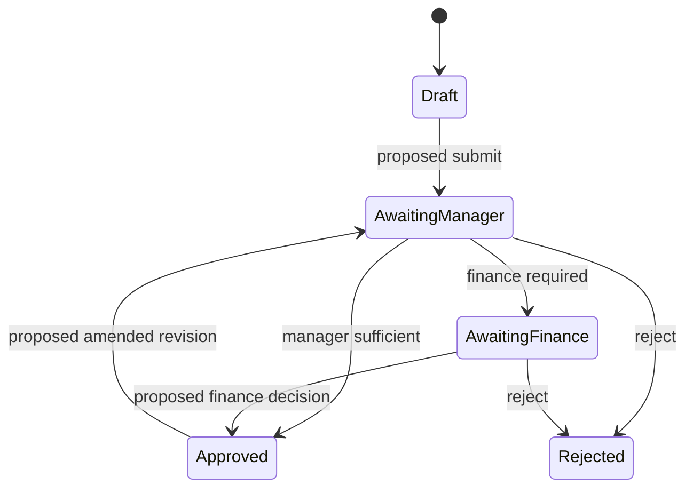

## Proposed architecture, never delivered

The fictional Purchasing Expansion was a paused discovery proposal for Meadow Office Services. It suggested expanding the delivered one-office pilot to additional offices and adding amount-based finance review. No sprint, schema migration, endpoint, acceptance environment, or production release was authorized. Every architecture, schema fragment, API, trace, and test in this engineering section is prospective. The proposal provides design options and unresolved questions, not a finished two-stage component.



The design favored a modular application and PostgreSQL rather than a separate workflow platform. It would adapt the pilot's revision-bound decisions while separating policy selection, authority resolution, and transition execution. This was a proposed direction, not an implemented module inventory. Procurement integrations, automated ordering, receipts, invoice posting, and payments remained separate concerns. A diagram could not resolve the business rules that Meadow had left undecided.

## Proposed data relationships

The expansion sketch identified `approval_policy_version`, `policy_stage`, `request_revision`, `stage_assignment`, `stage_decision`, and `request_event`. A submitted revision would identify the policy version used to construct its review route. A stage decision would identify request revision, policy version, stage, actor, and decision. An assignment would say who could act for a stage and office. The proposal did not define a validated migration or complete access policy.

```sql
-- Proposal fragment only; never applied in this fictional project.
CREATE TABLE stage_decision (
  id uuid PRIMARY KEY,
  request_id uuid NOT NULL,
  revision_number integer NOT NULL,
  policy_version_id uuid NOT NULL,
  stage text NOT NULL CHECK (stage IN ('manager', 'finance')),
  actor_id uuid NOT NULL,
  decision text NOT NULL CHECK (decision IN ('approve', 'reject'))
);
```

This fragment is deliberately incomplete. A real migration would need revision and policy foreign keys, command uniqueness, assignment relationships, timestamps, and a defined handling of rejection and repeated decisions. A unique index alone would not enforce ordered stages or distinct actors across rows. Those cross-row business rules belong in a well-defined transactional command. The workshop favored retaining history rather than updating two mutable approval flags, but it never signed off the final transition model.

## Policy alternatives that remained unresolved

Meadow had not chosen a finance threshold or whether the comparison used tax-inclusive, tax-exclusive, or another calculated total. The proposal considered a versioned definition so changes could be explained later. It did not supply a numeric approved rule. A future client's threshold must come from that client's own request. This proposal provides no delivered numeric threshold or evidence that a later client's requirements were implemented.

The workshop also left open whether manager and finance could be the same person, who maintained assignments, whether temporary delegates were allowed, and what happened when a finance reviewer was missing. A permission system could represent these choices but could not choose them for the client. Defaulting to auto-approval when no finance reviewer existed would silently create policy. The proposed conservative behavior was to block progression and surface a missing-assignment exception until a rule was agreed.

## Proposed state machine and command interface

The sketch considered draft, awaiting manager, awaiting finance, approved, and rejected states. Manager approval would advance either to finance or final approval according to the selected policy. Finance approval would require an effective manager decision on the same revision. An amendment would create a new revision and restart review; the workshop discussed this approach without fully agreeing all cases. Policy edits for requests already in flight remained a separate unresolved compatibility decision.



An illustrative `POST /purchase-requests/PR-X/decisions` would carry expected revision, stage, decision, and command key. The server would resolve actor identity, lock the request, load its pinned policy, check the stage route and assignments, and commit decision/state/event together. This endpoint was never implemented. It is useful for a future design review precisely because it exposes which inputs and authorities must be specified before development.

```typescript
// Proposal only: policy decisions must be agreed before implementation.
await transaction(async (tx) => {
  const request = await tx.lockRequest(requestId);
  const policy = await tx.policyForRevision(request.currentRevision);
  requireExpectedRevision(request, input.expectedRevision);
  requireNextStage(request, policy, input.stage);
  await requireAssignedActor(tx, actor, request, policy, input.stage);
  requireAgreedSeparationOfDuties(request, actor, policy);
  await tx.recordDecisionAndAdvance(request, actor, input, policy);
});
```

## Hypothetical success trace, not an acceptance result

The workshop could walk through an invented request whose total exceeded a placeholder policy threshold. The requester submitted revision 1; its policy route required manager then finance. A manager decision on revision 1 would advance it to awaiting finance. An eligible finance actor would review that same immutable revision and, if approved, create the final authorized state. A query would return the selected policy version and both decisions. No application executed this trace during the expansion project.

For a later client, the useful design question is what makes a route stable and explainable. Pinning a policy version at submission makes old decisions interpretable, but may leave older in-flight requests following earlier rules. Re-evaluating every in-flight request under the newest policy could invalidate pending decisions and require explicit migration. Meadow did not select between these alternatives. A future team must agree the behavior, not represent either as a historically delivered safeguard.

## Hypothetical failure traces and discovery questions

First, suppose a requester changes the total after manager review but before finance review. The favored sketch would create another revision and require new manager review, avoiding a finance decision on content that the manager never saw. The workshop had not closed the invalidation policy, so this remained proposed. A future test would submit the old finance screen and expect a revision conflict under the agreed restart-both-stages design. No passing result exists for this expansion.

Second, suppose finance approval arrives before manager approval or with no active finance assignment. The proposed command would reject stage-order or assignment failure without writing a final approved state. Third, suppose a policy threshold changes during review. The design must either retain the submitted policy or explicitly migrate and re-review, with events explaining the change. These are useful negative scenarios. They are not evidence that the archive already contains a repaired, deployed multi-stage engine.

## Pause decision, future tests, and handoff

The client paused the fictional proposal before funding implementation. The handover index initially grouped it with completed projects; the archive owner corrected the status to proposal only. The earlier one-office pilot remained delivered, while the expansion remained unimplemented. A preliminary four-week email estimate was contingent on policy decisions and cannot validate a future client's requested four-week schedule. No measured time saving, release date, capacity result, or completed implementation was established.

The prospective test matrix includes threshold-minus-one/exact/plus-one, tax calculation, manager-before-finance order, actor separation, amendment invalidation, stale decisions, missing assignments, command retries, and policy change during review. It should distinguish expected results from executed results, and include transaction rollback when event insertion fails. The proposal did not execute these tests. A new implementation should build a small vertical slice only after policy and authority ownership are confirmed.

A future client may already have resolved decisions that Meadow left open. Treat that client's explicit requirements as current decisions rather than reopening them merely because this historical proposal lacked a policy. Resolving those choices for a new design does not retroactively make this proposal delivered. Reuse the proposal's questions and policy-version concept alongside the delivered pilot's revision lesson, the expense portal's retry mechanism, and branch authorization precedent. Explicitly label the combined design as a new recommendation.

## Technical references and evidence status

- [PostgreSQL transaction isolation](https://www.postgresql.org/docs/current/transaction-iso.html) and [explicit locking](https://www.postgresql.org/docs/current/explicit-locking.html) support reasoning about atomic decisions and concurrent transitions.
- [PostgreSQL constraints](https://www.postgresql.org/docs/current/ddl-constraints.html) explains why relationships and uniqueness do not automatically enforce every cross-row policy.

Every expansion architecture, schema, API, worked trace, and test is prospective and fictional. External documentation supports technical reasoning only; it is not evidence that Threadline implemented this proposal.
